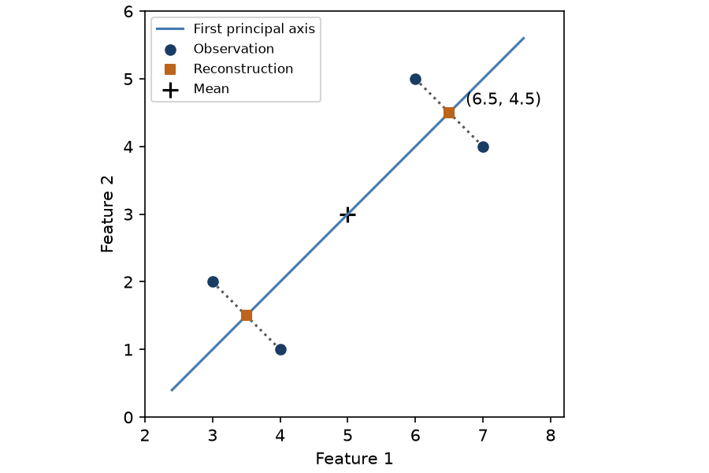

Imagine you can store only one number per observation with two features. You get to choose a common reference point and a line through it. For each observation you store its signed distance *along* the line. Which line lets you reconstruct the original points with the least total squared error?

## Start with the cloud, then choose its origin

Take the points $(7,4),(6,5),(3,2),(4,1)$. Their mean is $\mu=(5,3)$. Subtract it from every row and you get the matrix $X$ from the [SVD note](). Centering is what makes the question about variation *around the mean*. Translate the whole cloud ten units to the right and the centered matrix stays the same. With raw coordinates the distance to the origin would also influence the chosen direction.



## Why maximum variance also minimizes reconstruction error

For a centered observation $x$ and a unit direction $v$, its one-number **score** is $z=v^\top x$. The reconstructed centered point is $zv$. Its residual $x-zv$ is perpendicular to $v$. By Pythagoras,

$$
\|x-zv\|^2=\|x\|^2-z^2.
$$

Across the whole cloud the first term is fixed. The best line therefore maximizes the sum of squared scores $\|Xv\|^2$. Because the scores have mean zero, dividing this sum by $n-1$ gives their sample variance. That is the link between the two definitions of PCA you’ll encounter: maximum retained variance and minimum squared reconstruction error.

## Get the same answer two ways

**From covariance.** The sample covariance matrix is $C=X^\top X/(n-1)$. Each diagonal entry is a feature’s variance. An off-diagonal entry is the sum of the products of the two centered features divided by $n-1$. Its positive sign here means the features tend to rise together. The score variance along a unit direction is $v^\top C v$. The first eigenvector maximizes it. Subsequent components maximize the remaining variance subject to being perpendicular to the earlier ones.

**From SVD.** For centered $X=U\Sigma V^\top$, substitution gives $C=V\Sigma^2V^\top/(n-1)$. The columns of $V$ are the **principal axes** in feature space. Their variances are $\sigma_i^2/(n-1)$, and the matrix of observation scores is $XV=U\Sigma$. For these four points the variances are $18/3=6$ and $2/3$. The first axis explains $6/(6+2/3)=90\%$ of the variance.

## Follow one point through compression and back

The point $(7,4)$ becomes $(2,1)$ after centering. Choose the first axis $v_1=(1,1)^\top/\sqrt2$. The score is $3/\sqrt2$. Multiply the score by the axis and you recover $(1.5,1.5)$. Add the mean back and the reconstructed point is $(6.5,4.5)$. Now look at $(6,5)$ in the figure. Can you predict its score? Which information did the compression erase?

```python
import numpy as np

points = np.array([[7, 4], [6, 5], [3, 2], [4, 1]], dtype=float)
mean = points.mean(axis=0)
X = points - mean
U, s, Vt = np.linalg.svd(X, full_matrices=False)
scores = X @ Vt[:1].T
reconstructed = mean + scores @ Vt[:1]
variances = s**2 / (len(X) - 1)
np.testing.assert_allclose(reconstructed[0], [6.5, 4.5])
np.testing.assert_allclose(variances, [6, 2/3])
np.testing.assert_allclose(np.linalg.eigvalsh(np.cov(X.T))[::-1], variances)
```

## Read an embedding plot

With words as rows and embedding coordinates as columns, a dot on a two-dimensional PCA plot has coordinates $(x^\top v_1,x^\top v_2)$ for its centered embedding $x$. Two distant plotted points differ along retained directions. Two neighboring dots can still differ substantially along directions the plot dropped. Check the explained variance of those first two axes before interpreting a cluster. [Word-vector lab]()

Two choices matter when applying this to new data. First, fit the mean and axes on the training data and use those same quantities to project held-out rows. Otherwise the coordinate system moves. Second, consider the feature units. Converting one measurement from meters to centimeters multiplies its variance by 10,000. Standardizing each feature by its training standard deviation gives equal weight to a one-standard-deviation change in each feature. Choose the geometry that matches the question you want the plot to answer.
