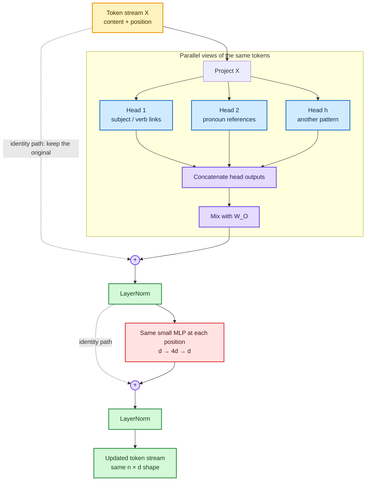

# The Transformer Block: Multi-Head Attention, Residuals, Norms, and Position

The [attention note](/posts/ml/2026-09-20-1-attention-turning-token-vectors-into-context) derived the single mechanism — softmax over query-key scores, times values — and ended with its two obvious weaknesses: one head can track only *one* relevance pattern at a time, and the whole operation is blind to token order.

> **Attention is blind to token order**
>
> This was highlighted in previous note here
> > **4. Sets, not sequences.** Nothing in the formula knows which token came first. Permute the input rows of $X$ and the outputs permute identically — attention is *permutation equivariant*: it treats the sequence as a bag of tokens with affinities. That's great for set-like inputs and a true bug for language, whose meaning is bound up in order ("dog bites man" ≠ "man bites dog"). Fixing that is positional encoding, coming in the next note.
>
> **One attention head can learn only relevance pattern at a time**
>
> This idea was only mentioned at the end of the previous note. It was never justified or derived.
>
> So let's try to make sense of it.
>
> Short answer: The answer lies in what happens when we compute $QK^\top$. From 3b1b's video **if this token is useful to another token, what information should it send?** If we think about it, a token can be useful to the next token in multiple different ways—for a given token A, its predecessor token B might be more useful when considering grammatical context, and token C might be more useful when considering semantic context. We are forcing one attention head to somehow capture all those relationships and turn them into one set of weights ($W_Q$, $W_K$, and $W_V$). Even if it somehow ends up capturing these different spatial relationships, at best they fight with each other and average them out.
>
> (Technically, $W_V$ (the Value weights) doesn't decide who to look at; it only decides what information to extract once the connection is made. The "fighting and averaging out" happens specifically inside $W_Q$ and $W_K$, which calculate the attention map.)
>
> **Long answer:**
>
> One attention head can only learn one relevance pattern at a time because the query-key interaction is governed by a single pair of linear projection matrices ($W_Q$ and $W_K$).
>
> When we compute $QK^\top$, we perform a single matrix multiplication that collapses the high-dimensional token representations into one scalar affinity score for every pair of tokens. Mathematically and conceptually, here is why this limits a single head to one "type" of similarity:
>
> 1. **The Rank and Geometry of the Attention Matrix**
>
>    The similarity matrix before softmax is computed as:
>
$$
A = QK^\top = (XW_Q)(XW_K)^\top = X(W_QW_K^\top)X^\top
$$
>
>    - **A single bilinear bottleneck:** The entire landscape of "what relates to what" in a single head is filtered through the combined matrix $M = W_QW_K^\top$.
>    - **One geometric transformation:** This matrix $M$ can only compress, rotate, or scale the input space in one specific way. If $M$ is trained to look for grammatical relationships (like matching a verb to its subject), it cannot simultaneously use those same dimensions to look for semantic relationships (like matching a pronoun to its antecedent) if those two patterns require orthogonal geometric transformations.
>
> 2. **The 3Blue1Brown Intuition: "What am I looking for?" vs. "What do I have?"**
>
>    In Grant Sanderson's (3Blue1Brown) visualization, a token uses its Query vector to ask a specific question, and other tokens use their Key vectors to answer it.
>
>    - A single query vector $q_i$ for a token is just a single direction in the embedding space.
>    - It represents one specific question (e.g., "Where is my corresponding noun?").
>    - A single key vector $k_j$ represents one specific label (e.g., "I am a noun").
>
>    If a token needs to ask multiple independent questions at the same time—such as "Where is my verb?" and "Where is the emotional sentiment in this sentence?"—it cannot do so with a single query vector, because the dot product $q_i^\top k_j$ will fuse all these signals into a single scalar value. The model would not be able to tell which of the two questions was actually answered.
>
> 3. **The Need for Multi-Head Attention (MHA)**
>
>    Because language is multi-faceted, a token does have multiple ways of being similar to other tokens. To fix the "one pattern at a time" limitation, the Transformer uses multi-head attention.
>
>    Instead of forcing one massive attention matrix to learn everything, the model splits the query, key, and value spaces into $h$ smaller subspaces:
>
>    - Head 1 can dedicate its $W_Q^{(1)}$ and $W_K^{(1)}$ to tracking positional relationships (e.g., looking at the immediate next token).
>    - Head 2 can dedicate its $W_Q^{(2)}$ and $W_K^{(2)}$ to tracking syntactic dependencies (e.g., matching adjectives to nouns).
>    - Head 3 can look for coreference resolution (e.g., mapping "it" back to "the dog").
>
>    By running these processes in parallel and concatenating the outputs, the model successfully processes multiple distinct relevance patterns simultaneously.

This note turns attention into the actual Transformer block. The block is attention plus four supporting acts — multi-head projection, a residual connection, layer normalization, and a small feedforward network — and then positional encoding bolted onto the input. None of them are exotic. Each one exists to patch a specific failure of the bare mechanism, and by the end you should be able to name the patch for each failure.

We keep the same style: every mechanism shown with its shape and its purpose. No new gradient formulas — every one of these components is either linear, an addition, a per-coordinate mean/variance, or an activation you already know.

---

## 1. Multi-head attention: why one pattern isn't enough

Remember the constraint from the previous note: attention's similarity table is built from *one* set of projections $W_Q, W_K, W_V$. That one geometry has to handle every relationship language has — which tokens are the subject, which "it" refers back to, which word is the verb, which adjective modifies which noun, and thousands more. One dot-product geometry can only encode "similarity along one shared direction of meaning" at a time.

The fix is simultaneously dumb and perfect: **run attention $h$ times in parallel, with $h$ different projection matrices**, each operating on a *slice* of the model's dimension. If the model dimension is $d_{\text{model}} = 512$ and we use $h = 8$ heads, each head gets $d_k = d_v = 64$ — literally columns 0–63 of $XW_Q^{(1)}$, columns 64–127 of $W^{(2)}$, and so on. Each head is a complete, independent attention table:


$$
\text{head}^{(i)} = \operatorname{softmax}\!\left(\frac{XW_Q^{(i)} (XW_K^{(i)})^T}{\sqrt{d_k}}\right) XW_V^{(i)}, \qquad i = 1, \dots, h
$$

Then concatenate the eight $n \times 64$ outputs into one $n \times 512$ matrix and pass it through one final learned matrix $W_O$ of shape $(512, 512)$:

$$
\operatorname{MultiHead}(X) = \big[ \text{head}^{(1)} ; \text{head}^{(2)} ; \dots ; \text{head}^{(h)} \big] \, W_O
$$

Notice two properties before moving on:

- **Cost doesn't explode.** One $512 \to 512$ projection is eight $512 \to 64$ projections by parameter count; similarly for computing scores. Multi-head is the same parameter and FLOP budget carved up — nothing extra to pay for, just re-organized.
- **The subspaces can specialize.** Because each head lives in its own 64-dimensional slice, there's no geometric competition: head 1's slice can become the "subject-verb agreement" geometry while head 2's becomes the "pronoun resolution" geometry. Trained transformers' heads do in fact end up showing distinctly different attention patterns (syntax-tracking, position-tracking, delimiter-tracking), though never in the clean categories our labels would like.

**Intuition to keep:** one-head attention is a single "who-listens-to-whom" vote on one shared notion of relevance; multi-head is $h$ simultaneous votes, each with its own definition of relevance, merged afterward.

> Let's understand it line by line.
>
> First let's consider the single attention case, let's say we have embeddings with 512 features. Let's say all $W_Q$, $W_K$ and $W_V$ are of dimension (512, 512) for simplicity (it contractis the fact we learnt previously, $Q$ and $K$ are in very low dimension compared to $E$ and $V$ will be on similar dimension as $E$.)
>
> Now we understood the limitation with single attention block that with one $Q$ and $K$ it will be suboptimal to learn about spatial relationships in multiple directions.
>
> So the idea is to break the $W_Q$, $W_K$ and $W_V$ matrices of dimension $(512, 512)$ into, let's say, 8 heads: $W_Q^{(1)}$, $W_Q^{(2)}$, $W_Q^{(3)}$, ..., $W_Q^{(8)}$. Each head has dimension $(512, 512/8) = (512, 64)$.
>
> Now the input embeddings $E$ of dimension $(512, 512)$ are passed as-is to each attention block in parallel.
> **The important point here is that each individual attention block is still looking at the entire input; we are not dividing the feature columns between attention blocks.**
>
> Now each attention block calculates its own output. If we remember from the previous note, the output of attention is $\Delta\vec{E}$, which is what we add to the original $E$ to get the enriched embedding.
>
> **Single head:**
>
$$
\begin{aligned}
Q, K &: n \times d_k \\
S &= \frac{QK^\top}{\sqrt{d_k}} \quad:\ n \times n &&\text{one score matrix} \\
A &= \operatorname{softmax}(S) \quad:\ n \times n &&\text{one weight matrix} \\
\Delta\vec{E} &= AV \quad:\ n \times d_v
\end{aligned}
$$

> **For multi-head**
>
> We will introduce another intermediate variable $O$.

<div style="text-align: left;">

$$
\begin{aligned}
&\text{Multi-head: }h = 8,\ d_k = 64 \\[4pt]
&\text{For each head }i: \\
&\qquad Q_i, K_i : n \times 64 \\
&\qquad S_i = \frac{Q_iK_i^\top}{\sqrt{64}} : n \times n
&&\text{head }i\text{'s own score matrix} \\
&\qquad A_i = \operatorname{softmax}(S_i) : n \times n
&&\text{head }i\text{'s own weight matrix} \\
&\qquad O_i = A_iV_i : n \times 64 \\[4pt]
&\operatorname{concat}(O_1,\ldots,O_8) : n \times 512 \\
&\operatorname{concat}(O_1,\ldots,O_8)W_O : n \times 512
&&W_O \in \mathbb{R}^{512 \times 512}
\end{aligned}
$$

</div>

>
> $\Delta\vec{E} = [O_1, O_2,..., O_h] W_O$
>
> To understand it one step further, let's look at dimensions:
>
>
> Partition $W_O$'s $(512, 512)$ rows into $h$ blocks:
>
$$
W_O =
\begin{bmatrix}
W_O^{(1)} \\
W_O^{(2)} \\
\vdots \\
W_O^{(8)}
\end{bmatrix},
\qquad
W_O^{(i)} \in \mathbb{R}^{64 \times 512}
$$

> So what we end up doing is basically:
$$
C W_O = O_1 W_O^{(1)} + O_2 W_O^{(2)} + \cdots + O_8 W_O^{(8)}
$$
> That's exactly "tell the NN to find the optimal combination" — but note it's linear combination with learned matrices, not just learned scalars. And it's unavoidable for a second reason: we took $d_v = d_model$ as convinience in all our examples, but if they're different $W_O$ is what brings it back to $d_model$


---

## 2. Residual connections: the gradient highway

A bare stack of many multi-head attention and feedforward stages — 24, 96 layers — would immediately run into the vanishing-gradients story from our activation-functions note: each layer's slope on the backward path multiplies. The Transformer survives only because of an architectural cheat:

$$
Y = X + \operatorname{SubLayer}(X)
$$

Formally, every sublayer (attention or feedforward) wraps itself: the *output is the sum of the input and the sublayer's transformation*.

Now follow the backward pass through it — this is one algebraic line but has oversized consequences. Let $Y = X + F(X)$. Then:

$$
\frac{\partial Y}{\partial X} = I + \frac{\partial F}{\partial X}
$$

The identity term is an **unimpeded slope-1 highway** through this layer. Even if the sublayer's derivative is terrible — near zero, saturated, dead — the input's signal can still pass straight through via the $I$, completely unharmed. Error arriving at a deep layer can chain these identity hops all the way back to the input with no multiplicative decay. This is why transformers can stack 96 blocks where plain 96-layer MLPs collapse.

Your ReLU-note realization ("ReLU's slope is exactly 1 on the active side — messages pass unaltered") is the same idea at smaller scale: residuals are ReLU's slope-preservation promoted from neuron level to layer level. The architecture is engineered around keeping slope-1 paths available *somewhere* for every gradient, always.

There's a second, subtler benefit: the sublayer no longer has to *preserve* anything it doesn't want to change. Without residuals, each layer must be trained to reconstruct-and-improve; with residuals, a layer can output a pure *correction* — it edits rather than rewrites. "What should I add to the current representation?" is a much easier question to learn than "re-express the entire representation, slightly better."

> What's described above is actually simpler than it sounds:
>
> Imagine you are a teacher at the end of a long hallway with 96 doors in a row. You need to whisper a message to a kid behind the 96th door.
>
> In an old-school neural network, the message has to pass through every single room. The kid in room 1 tells room 2, room 2 tells room 3, and so on. If even one kid along the way mumbles or forgets the message (like a fading Sigmoid gradient), the message is completely lost by the end. By room 96, you get total silence.
>
> A Residual Connection builds a giant straight hallway next to the rooms.Every single room has a back door opening right into the hallway. Now, when you want to pass a message, it doesn't get mumbled from room to room. It travels straight down the empty hallway completely unhindered. If room 45 wants to add a little note to the message, it steps out into the hallway, drops its note in the basket, and the message keeps rolling.
>
> **Connecting it to what you know: Sigmoid vs. Identity**
>
> Think about the math you already know. With a sigmoid activation, during the backward pass, you multiply by the derivative, $\sigma'(x)$. Because that derivative is always less than $0.25$, multiplying it 96 times shrinks your gradient toward zero.
>
> The residual formula changes the game entirely:
>
$$
Y = X + F(X)
$$
>
> When you take the derivative, the $X$ term contributes $1$:
>
$$
\frac{\partial Y}{\partial X}=1+\frac{\partial F(X)}{\partial X}
$$
>
> Instead of multiplying a chain of tiny fractions (like $0.2 \times 0.1 \times 0.2$), you now have factors that look like $(1 + \text{something})$. Even if that residual derivative becomes $0$, the $1$ remains untouched.
>
> That $1$ is a literal multiplication shield. It means the gradient can hop backward through 96 layers by multiplying by $1$ over and over again.
>
> **The "Editor" vs. "Author" Shift**
>
> Without this trick, a layer has a massive job: it has to take the entire 512-dimensional token vector, retain everything important about it, and rewrite a brand new version of it that is slightly better. That is incredibly hard to learn.
> With the residual highway, the layer doesn't have to rewrite the book. It just writes a tiny sticky note ($\Delta E$) and adds it to the original vector ($X$). It shifts the layer's job from rewriting to editing.
>
> ### The most important takeaway from this
>
> The formula $Y = X + F(X)$ didn't come randomly, it solves 2 things at once. If we remember from previous note 3b1b mentioned how we treat the output of attention block as $\Delta E$. But we see we got 2 problems:
> 1. Multi-attention blocks introduces/amplifies the problem of vanishing gradients: we might think how? because they are in parallel, gradient of one attention head doesn't interfere with other parallel sibling attention head right? True, but imagine what happens once an gradient has travelled through 10 parallel siblings and reached its start and now it has to visit the previous multi-attention block. Suddenly we see gradients of all 10 parallel attention heads multiply! and they cascade to vanish.
>
> **What actually happens:** Parallel paths (like the 8 or 10 sibling heads within one layer) actually add their gradients together when they merge back, rather than multiplying them. Parallelism itself does not cause vanishing gradients.
>
> **Where the real danger lies:** The vanishing gradient problem happens sequentially (vertically) as you go from layer to layer, not horizontally across heads.
> 
> 2. We treat the output of attention block as $\Delta E$, but this wasn't the case initially until we added residual connection (3b1b didn't go into residual connection in that video yet, but he didn't mislead as well). The reason we treat the output of multi-attention block as $\Delta E$ is solely because of residual connectiom.
>
> More on point 2:
>
> Without a residual connection, the attention sublayer's output would replace the current representation. It could in principle learn to preserve useful information while adding context, but then preservation and contextual updating would both be its job.
>
> With a residual connection, the whole attention sublayer can instead provide an update $\Delta E$, and the architecture adds it to the current representation: $E_{\text{new}}=E+\Delta E$. More precisely, a raw attention head's output is not inherently a delta; in multi-head attention, the head outputs are combined and projected by $W_O$, and that sublayer result is what the residual branch adds.
> This connects to Grant Sanderson's (3Blue1Brown) residual-stream picture: the token representations form a shared river of information flowing through the Transformer. Think of one $d_{\text{model}}$-dimensional vector per token, carried from layer to layer. Each sublayer reads the current stream, computes an update, and adds that update back.
>
> In a pre-norm Transformer, one block makes two such updates. Writing $x_\ell$ for the whole token stream entering a block:
>
> $$
> x^{\text{attn}}_\ell = x_\ell + \operatorname{Attn}(\operatorname{LN}(x_\ell))
> $$
>
> $$
> x_{\ell+1} = x^{\text{attn}}_\ell + \operatorname{FFN}(\operatorname{LN}(x^{\text{attn}}_\ell))
> $$
>
> The first branch gathers information across token positions; the second processes each token's vector independently. In both cases, the branch computes an update and the residual path carries the existing stream forward. For one sublayer, the pattern is simply:
>
> $$
> x_{\text{next}} = x_{\text{current}} + \text{update}
> $$
>
> Three useful things follow:
>
> 1. **The stream is an additive path.** The branch may do complicated nonlinear computation, but its result is added to the stream. In the pre-norm form, the stream itself continues along the direct path; a layer can add context without having to rebuild the entire representation.
> 2. **Layers read the full token representation.** LayerNorm's output is fed into the learned projections, such as $W_Q$, $W_K$, and $W_V$ for attention, or the feedforward network's weights. Each head reads the whole $d_{\text{model}}$-wide token vector and maps it into its own learned spaces; heads do not each own a slice of the original input.
> 3. **Updates are writes into the stream.** Attention heads first produce separate outputs. Those outputs are combined by concatenation and $W_O$; the resulting attention update is added to the residual stream. The heads do not overwrite the stream or add directly to it one at a time.
>
> Compare this with two other patterns:
>
> - **RNN:** $h_t=f(x_t,h_{t-1})$. The next hidden state replaces the previous one, so information from earlier steps must be carried forward inside the new state.
> - **Plain deep network:** $x_{\ell+1}=f(x_\ell)$. Each layer replaces its input representation; preserving useful information is part of what that layer must learn.
> - **Residual stream:** $x_{\ell+1}=x_\ell+\text{update}_\ell$. The old stream has a direct route forward while the layer contributes an update.
>
> **A tiny example.** Let a toy stream be $x_0=[a,b,c]$. Suppose an early layer writes $[2,0,0]$:
>
> $$
> [a,b,c] + [2,0,0] = [a+2,b,c]
> $$
>
> A later layer can read the first coordinate and use the contribution that is already there; it does not need to recover it by passing through every intervening layer. If that later layer writes $[0,1,0]$, the stream becomes $[a+2,b+1,c]$. This is only a toy picture—the coordinates in a real model are learned features, not literal slots named $a$, $b$, and $c$—but it shows how additions can accumulate.
>
> There is a parallel with attention: attention gives information a direct route **between token positions** within a layer, while residual connections give information and gradients a direct route **between layers**. Both shorten a path that would otherwise have to pass through many intermediate steps.
>
> The stream is not an unlimited memory bus. Its width stays at $d_{\text{model}}$, so different features share the same coordinates and can overlap or interfere. Also, repeated additions can change the stream's scale; that is one reason normalization is used. LayerNorm helps manage scale, while its learned gain and shift let the model adjust the normalized values.
>
> In a simplified additive stream followed directly by a linear unembedding $W_U$, the final logits can be written as contributions from the starting stream and each update:
>
> $$
> x_L = x_0 + \sum_{\ell=0}^{L-1} \text{update}_\ell
> $$
>
> $$
> \text{logits} = W_U x_L = W_U x_0 + \sum_{\ell=0}^{L-1} W_U\,\text{update}_\ell
> $$
>
> This makes the additive picture useful for thinking about how layer updates affect predictions. In an actual model, a final normalization or other intervening operation can change that simple decomposition.
>
> **One precision note for the diagram in this note:** it shows the original post-norm arrangement, where LayerNorm follows the residual addition: $x_{\ell+1}=\operatorname{LN}(x_\ell+F_\ell(x_\ell))$. That normalization rescales the summed representation, so the stream is not a perfectly untouched accumulator across the whole block. Many modern Transformers use pre-norm: $x_{\ell+1}=x_\ell+F_\ell(\operatorname{LN}(x_\ell))$. There, normalization is applied to what the branch reads, and the residual stream itself keeps the direct additive path between sublayers.

---

## 3. Layer normalization: keeping the numbers sane

Residuals have hidden cost: if every block **adds** onto the running representation, activations drift and grow as blocks stack up. Feed a drifting 500-dimensional vector through softmax, it saturates; statistics slide, and training gets brittle. You need something that resets the scale per token, per layer, without asking for a batch. That is LayerNorm.

For one token's vector $h$ of width $d$:

$$
\mu = \frac{1}{d}\sum_i h_i, \qquad \sigma^2 = \frac{1}{d}\sum_i (h_i - \mu)^2
$$
$$
\hat{h} = \frac{h - \mu}{\sqrt{\sigma^2 + \epsilon}} \odot \gamma + \beta
$$

with learned per-feature gain $\gamma$ and shift $\beta$. It standardizes each token's vector to mean 0 / variance 1, then lets training rescale and reshift it.

Three contrast points with BatchNorm, since that name comes up everywhere:

- LayerNorm normalizes **across features within a single token**. BatchNorm normalizes **across the batch for one feature**. LN's statistics are therefore independent of batch contents — a model sees the same normalization with a batch of 1 or 10,000, at training or inference. That consistency is precisely what sequence modeling needs (BN statistics flip between train and inference; LN's don't).
- $\gamma$ and $\beta$ mean normalization *isn't* constraining the model's expressiveness. If the model needs mean 3 / std 40, it learns exactly that. LN fixes scale *pathology*, not scale.
- Normalization shows up twice per block in modern transformers: $\text{Attention} \to \text{AddNorm}$, $\text{FFN} \to \text{AddNorm}$.

The block so far:



Imagine one ribbon of token vectors taking two routes at once: attention sends it through several differently colored lenses, while the faint bypass carries the untouched ribbon around the sublayer. The plus node adds the learned update back to that original stream. After the MLP does its per-token edit, a second bypass repeats the same idea. Every stage returns the same number of token vectors, ready for the next block.

> ### The idea of Normalization in Neural Networks
>
> Normalization is the process of scaling input features or intermediate layer activations to a common, balanced range (such as $[0, 1]$ or a zero mean and unit variance). [1, 2, 3] 
> 
> We need normalization in neural networks for several key reasons:
> 
> #### 1. Prevents Feature Dominance
>
> - Features with large numerical ranges (e.g., annual income in the hundreds of thousands) can overshadow features with small ranges (e.g., age or number of items, which are single or double digits).
> - Normalization ensures that all features contribute equally to the initial weight updates and model learning. [1, 3, 4, 5] 
>
> #### 2. Stabilizes and Speeds Up Gradient Descent
>
> - Unnormalized data creates an elongated, distorted loss landscape (shaped like a steep valley or a long ravine). [1, 6] 
> - In this distorted landscape, gradient descent takes a slow, "zig-zagging" path toward the minimum, and large step sizes can cause the model to diverge. [1, 3, 7] 
> - Normalizing the inputs makes the loss function more symmetrical or "spherical," allowing gradient descent to march straight and fast toward the optimal solution. [1, 6] 
>
> #### 3. Avoids Activation Function Saturation
>
> - Large input values can push the activations of neurons into the flat regions (saturation zones) of functions like Sigmoid, Tanh, or ReLU (causing "dead ReLU" or vanishing gradients).
> - Keeping inputs and activations within a tractable, scaled range keeps the gradients active and flowing smoothly during backpropagation. [2, 3, 4, 8] 
>
> #### 4. Mitigates Internal Covariate Shift (in Deep Networks)
>
> - As weights change in earlier layers during training, the distribution of inputs to deeper layers constantly shifts.
> - Techniques like Batch Normalization or Layer Normalization re-center and re-scale intermediate activations between layers, stabilizing deep network training and allowing for higher learning rates. [1, 3, 9] 
>
> #### Common Normalization Methods
>
> - Min-Max Scaling: Rescales data strictly to a fixed range, usually $[0, 1]$ or $[-1, 1]$. [2] 
> - Standardization (Z-score normalization): Transforms data to have a mean of 0 and a standard deviation of 1 by subtracting the mean and dividing by the standard deviation. [2, 10] 
> - Batch / Layer Normalization: Applies scaling dynamically across mini-batches or individual network layers during deep learning training. [3, 9] 
>
> ### 1. BatchNorm 
>
> The idea isbest explained in an image: 
> 
> 
>
> Let's say we are training with SGD in batches, we normalize features of a given batch which will force them to have mean 0 and variance 1. The whole idea is NN cares more about the relative distribution of features. 
>
> But applying directly to inputs like that sounds absurd, what if the magnitude was really needed to learn some important pattern? That's why we don't apply it on raw inputs but on the logits, before passing to activation functions. 
>
> ```
> Input X
>    ↓
> Linear layer: Z = XW + b
>    ↓
> BatchNorm(Z)          ← 
>    ↓
> ReLU(Z_normalized)    ← activation
>    ↓
> Next linear layer
>    ↓
> BatchNorm
>   ↓
> ReLU
>   ↓
> ...
> ```
>
> The question we asked for inputs holds for logits as well: "If we’re forcing every token to have mean zero and variance one, aren’t we restricting what the model can represent?"
>
> That's why we include 2 learned parameters for each logit
>
> Apply the learnable parameters $\gamma$ (scale) and $\beta$ (shift) to get the final adjusted logit $y_{i}$, which is then passed directly into your activation function: $y_{i}=\gamma \hat{x}_{i}+\beta$
>
> This will allow the model to decide if some scaling and shifting back is required rather than keeping it grounded at mean 0 and variance 1.
>
> The reason Batch Norm works is still debated, but it has been proven to give very good results during training.
>
> ### 2. LayerNorm 
>
> Since we learnt BatchNorm, let's understand why its not usable for language models. In traditional neural networks the input data is lined up such that each feature column corresponds to some particular feature for all inputs. But if we think about language models, their inputs are sentences represented as tokens. To begin with, each sentence may not be same lengths, and what does it mean by normalizing embeddings of the word "The" with "It"? Its absurd and won't help. 
> THis is the general idea of LN. Before we go any further, its very important to stop and ask where do we apply LN? 
>
> #### 1. Pre-LN (Modern Standard: GPT, LLaMA, PaLM)
>
> In modern deep networks, LayerNorm is applied before Multi-Head Attention (MHA). The output of MHA is added directly to the identity stream without another normalization step.
> - The flow:
>
$$
\mathrm{Output} = X + \operatorname{MHA}\left(\operatorname{LN}(X)\right)
$$
>
> - Why this matters for your paper: This is exactly why variance accumulates in your 96-layer example. Because the identity path (X) completely bypasses LayerNorm, the activations grow layer after layer until they hit a final global LayerNorm right before the output layer.
>
> **Why this makes sense with what we just learnt?**
>
> 1. LN is applied to inputs of MHA and FFA, not directly on embedding E.
> 2. Every layer gets the residual connection containing modified version of E till that point, which is not normalized in any way. So pouring back to river analogy holds - because river itslef is nor normalized.
>
> **Why Attention and FFN still work on normalized vectors?**
>
> Here is exactly how a modern Pre-LN network processes your data from the raw text to the final layer:
> 
> - **At the absolute start (Layer 0):**
>
$$
X_0 = \operatorname{TextEmbeddings} + \operatorname{PositionalEncodings}
$$
>
> - **Inside each transformer layer:**
>
$$
X_{\text{mid}} = X_{\ell-1} + \operatorname{MHA}\left(\operatorname{LN}(X_{\ell-1})\right)
$$
>
$$
X_\ell = X_{\text{mid}} + \operatorname{FFN}\left(\operatorname{LN}(X_{\text{mid}})\right)
$$
>
> - **At the absolute end (after 96 layers):**
>
$$
\mathrm{FinalOutput} = \operatorname{LinearProjection}\left(\operatorname{LN}(X_{96})\right)
$$
>
> **The Core Takeaway**
>
> The main residual highway ($X$) never gets permanently normalized.
> LayerNorm is only a temporary filter applied to a copy of $X$ right before it enters a sub-block ($\operatorname{MHA}$ or $\operatorname{FFN}$). The raw, accumulating highway keeps moving straight through the model untouched.
>
> #### 2. Post-LN (Original 2017 Transformer Paper)
>
> In the original architecture, LayerNorm is applied after the residual addition.
> - The flow:
>
$$
\mathrm{Output} = \operatorname{LN}\left(X + \operatorname{MHA}(X)\right)
$$

> - The drawback: While this keeps activation magnitudes perfectly scaled at every layer, it scales down backpropagating gradients exponentially. This makes it notoriously unstable and nearly impossible to train at 96 layers without massive learning rate warmups.

| Architecture | Placement Relative to MHA | Math Formula | Hidden State Behavior |
|---|---|---|---|
| Pre-LN (96-layer friendly) | Before MHA | $X + \operatorname{MHA}(\operatorname{LN}(X))$ | Magnitudes grow continuously across layers. |
| Post-LN (Original) | After MHA + Addition | $\operatorname{LN}(X + \operatorname{MHA}(X))$ | Scale stays stable, but gradients vanish in deep networks. |


---

## 4. The feedforward network: nonlinear memory per token

After attention does the *routing* (who mixes with whom), each token's vector passes independently through a tiny two-layer MLP:

$$
\operatorname{FFN}(y) = W_2 \, \sigma(W_1 y + b_1) + b_2
$$

with widths $d \to 4d \to d$ (512 → 2048 → 512). Two things worth noticing in view of where we've been:

- **Same activation conversation as before.** Early transformers used ReLU; modern ones use GELU — the activation-function note's ending shows up straight away. The nonlinearity here is what lets the whole model stack compute more than linear maps — the reasoning from "linear layers collapse" applies inside the block too.
- **This is where "knowledge" tends to sit.** Attention moves information between tokens; the FFNs process it per token. Some mechanistic interpretability work reads the FFN as a soft key-value memory — first layer retrieves pattern-activated directions, second layer writes facts. Whether or not that story fully holds, "attention routes, FFN stores" is a decent rough partition of labor.

Position-independent: every token goes through the *same* $W_1, W_2$; FFN applies at each position separately. Attention is the only place where tokens talk.

---

## 5. Positional encoding: giving a set back its order

Section 5 of the previous note derived why attention is permutation equivariant: permute the input rows, and every score, weight, and output row permutes identically. Meaning has no visibility into order. A transformer with embeddings alone *provably* cannot distinguish "dog bites man" from "man bites dog", no matter how it's trained, because the two sequences only differ in order.

The patch: give each position a vector and **add it directly to the token's embedding** at the input:

$$
\tilde{x}_i = x_i + p_i
$$

Now content and position are entangled from layer 0 and attention's scores see both. The classic "Attention Is All You Need" choice is a fixed, deterministic function of position:

$$
\operatorname{PE}(\text{pos}, 2i) = \sin\!\left(\frac{\text{pos}}{10000^{2i / d}}\right), \qquad
\operatorname{PE}(\text{pos}, 2i+1) = \cos\!\left(\frac{\text{pos}}{10000^{2i / d}}\right)
$$

Sinusoids with geometrically increasing wavelengths. The one-paragraph why: think of an odometer / binary counter — each "digit" ticks at a different rate. High-frequency coordinates (small $i$) change fast (distinguish nearby positions); low-frequency ones change slowly (encode rough location). Combination ≈ a unique fingerprint of "position". Beyond fingerprints, the frequencies are chosen so "shift by $k$" is a *linear map* of the encoding — attention can learn relative offsets from queries and keys that read the fingerprints.

Modern variants you'll meet (one-line each): learned absolute position embeddings (train a position embedding matrix like a second embedding table); RoPE (rotate query/key vectors by a position-dependent angle — relative offsets emerge geometrically; common in current LLMs); ALiBi (just subtract a distance penalty from scores). All are answers to "attention doesn't know order; inject order."

---

## 6. Causal masking: how decoders can't peek

One more ingredient distinguishes text *generation* models from encoders. If a model's job is "given a prefix, predict the next token", then during training on the sentence "the cat sat", the position of "cat" would *see* the positions of both preceding and following words by default — including "sat", the very token it's supposed to predict there. That's leakage: the network could cheat by reading the answer.

The fix is to force every query position $i$ to look only at keys $j \leq i$: before softmax, overwrite the upper triangle of the score matrix with $-\infty$:

$$
\frac{QK^T}{\sqrt{d_k}} \;+\; M, \qquad
M_{ij} = \begin{cases} 0 & j \leq i \\ -\infty & j > i \end{cases}
$$

Softmax of $-\infty$ is 0 (exactly). Every row is now a probability distribution over "this token and everything before" — future positions simply carry no weight. Row $i$'s weighted sum therefore involves only values from positions $\leq i$. Mathematically there is **no path by which future information reaches a position's output** — one more case where "doesn't just discourage cheating, makes it impossible" is the reassuring framing.

This is the entire difference between "encoder-style" attention (BERT: full visibility, best for understanding) and "decoder-style" attention (GPT: causal mask, best for generation). The rest of the architecture is shared.

---

## 7. The full block and model, assembled

One Transformer decoder block, end to end, $n$ tokens and width $d_{\text{model}}$:

```text
input: H  (n × d_model), token-embedding + positional encoding already added

1. masked multi-head attention   A = MHA(H)                # n × d_model
2. residual + layernorm          H = LN(H + A)
3. feedforward (d → 4d → d)      F = FFN(H)
4. residual + layernorm          H = LN(H + F)
output: H (same shape; stack another identical block)
```

Then stack — GPT-2 small uses 12 of these; big models use dozens — and put a final linear "language model head" on top mapping $d_{\text{model}} \to V$ for next-token logits. The LM head, softmax trick, and training objective, end-to-end with real text, is the next note.

A couple of quick parameter-count checks to anchor sizes, all of which you can verify from shapes alone (this is a reasoning exercise, no arithmetic required yet): with $d_{\text{model}} = 512$ and 4 heads:

- $W_Q, W_K, W_V$ slice sizes: $512 \times 128$ each in that variant; queries/keys/values have to be re-merged by $W_O$: $512 \times 512$.
- FFN: $512 \times 2048$ and $2048 \times 512$.

The FFN carries about twice the parameters of the attention sublayer — consistent with "routes vs remembers" split.

---

## 8. Exercises — reasoning only

1. Residuals: in a block $X \to X + F(X)$, trace a gradient backward when $F$ is "perfectly dead" (zero derivative). What does the input get? Why is that the *minimal* information needed to train everything upstream of this block?
2. Suppose we multiply the input embeddings by a huge constant (say 30) before the model. Walk the pipeline (scores, softmax, LN, and eventually FFN) and explain whether and where that scale gets corrected. Which component saves you, and why does it?
3. One-head vs multi-head: if you *concatenate* 8 heads of 64 dims, the result is linear in each head's output. Prove that one big attention with a block-diagonal $W_V$ is the same as multi-head without enhancements, then explain which ingredient in the real multi-head recipe lets heads *combine* rather than merely *stack*.
4. Why is causal masking done by *adding* $-\infty$ to scores rather than zeroing out the attention weights after softmax? (Hint: think about the gradient.)
5. If I give the model relative-position information instead of absolute, can it still answer "which word is third?". What task would expose the difference between absolute and relative position encodings?
6. Argue why the FFN's widening ($d \to 4d$) is necessary by linking back to your linear-layers-collapse observation from the activation notes. What would two consecutive linear 512→512 layers without nonlinearity be equivalent to?
7. Consider a 2-token sequence at inference time. Describe the mask matrix and its effect row by row: which value vectors can token 1's final representation depend on? Which can token 2's?

---

## 9. What comes next

The block is fully mechanical: mask, attend, add & norm, FFN, add & norm, repeat. Nothing yet explains how this becomes *a language model* — where does the probability over the next token come from, what is the loss, why is teacher forcing legitimate, and why this setup specifically beat RNNs so thoroughly. That end-to-end training picture is the [next note](/posts/ml/2026-09-20-3-training-a-language-model-end-to-end).
