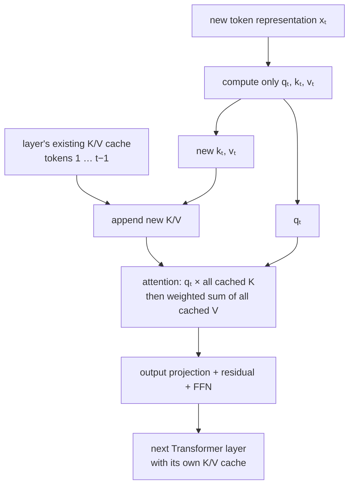

# KV Cache: Making Autoregressive Generation Practical

The [language-model training note](/posts/ml/2026-09-20-3-training-a-language-model-end-to-end) ended with an asymmetry: training processes every position in parallel, but generation produces one token at a time. Each new token is appended to the context, and the model is run again to predict the next one.

If we implement that loop literally, we repeat an enormous amount of work. To generate token 100, we recompute the embeddings, queries, keys, values, attention outputs, and feedforward outputs for tokens 1 through 99 — even though we already computed all of them in earlier iterations.

The **KV cache** removes that repetition. The idea is not a new model or a new approximation. It is simply:

> **Once a token's keys and values have been computed at a layer, keep them. When the next token arrives, compute only that token's forward pass and let it attend to the stored keys and values.**

That is the whole idea. The rest of this note is seeing why it is valid, what exactly gets cached, and why this simple reuse changes both the runtime and the memory story of LLM inference.

---

## 1. Start with the naive generation loop

Suppose the prompt is:

```text
the cat sat
```

and the model generates `on`, then `the`, then `mat`.

A literal implementation looks like this:

```text
model([the, cat, sat])          → predict on
model([the, cat, sat, on])      → predict the
model([the, cat, sat, on, the]) → predict mat
```

At each step, the final position produces the logits we actually use. But because the whole sequence went into the model, every position went through every Transformer block again.

```text
                     tokens processed at each call
call 1:              the  cat  sat
call 2:              the  cat  sat  on
call 3:              the  cat  sat  on  the
                     ↑    ↑    ↑
                     recomputed every time
```

This feels wasteful, but waste alone does not prove that reuse is correct. Perhaps the old token representations changed when a new token arrived. If they did, we would have to recompute them.

Causal masking is what makes reuse correct.

---

## 2. Why old computations do not change

From the [Transformer block note](/posts/ml/2026-09-20-2-the-transformer-block), causal attention allows position $i$ to attend only to positions $j \leq i$:

$$
M_{ij} = \begin{cases}
0 & j \leq i \\
-\infty & j > i
\end{cases}
$$

So when we append a new token, it can read earlier tokens, but earlier tokens cannot read it. Their attention weights, outputs, residual streams, and feedforward outputs remain exactly what they were before.

```text
Before appending `on`:

the  → can see: the
cat  → can see: the, cat
sat  → can see: the, cat, sat

After appending `on`:

the  → can see: the                    unchanged
cat  → can see: the, cat               unchanged
sat  → can see: the, cat, sat          unchanged
on   → can see: the, cat, sat, on      new
```

This property holds independently at every layer. If all inputs visible to an old position are unchanged at layer 0, its output from layer 0 is unchanged. The same argument then applies at layer 1, layer 2, and so on.

Therefore, recomputing old positions does not merely give approximately the same answer. In exact arithmetic, it gives **the same answer**.

That creates an opportunity: run the old work once, save the parts future tokens will need, and never do it again.

> **Difference during trainign and inference**
>
> We saw during inteference, the model has to parse the whole sentence everytime just to predict the next token, this seems correct but let's understand why. We also learnt only last token is used to predict the next token which seems to contradict this, but it doesn't. If we think about it, last transformer block's output for last token in the sentence is so enriched that it contains context for entire sentence. But the reason it got so enriched is because we had to run the whole sentence for it to see all it's previous tokens. 
>
> Now we can naturally observe that whenever we add one extra token to the sentence, attention pattern matrix will get one extra row and column there won't be any change in existing matrix because previous tokens never see this token because of casual masking. This means just compute $Q$, $K$ and $V$ for the new token, dot the new $Q$ and $K$ with previous token's $Q$ and $K$ and multiply with newly added column with V after softmax and division by root of $d_k$. 
>
> **But what happens when multi-attention merges?**
>  
> We still need to prove that the $\Delta E$ added by MHA block is same as before it just gets an additional column for the newly added token, otherwise if there are changes to previous token's $\Delta E$, then it means the input received by next transformer block is no longer the same, so their older $K$, $Q$ and $V$ no longer remain same. We already know this is true intuitively because of casual masking but let's try to see it from mathematical formulas as well. 
>
> At the end of MHA, each attention head has computed a $A_{i}V$ matrix called $O_{i}$ of dimension $(n, d_v)$, here n will increase by 1, so each matrix will have another row. Each $O_{i}$ will be stacked columnwise and multiplied by another matrix $W_{O}$ of dimension $(d_v, d_{model})$ (remember we highlighted the purpose of this matrix to bring back the vector to original embedding dimension $d_{model}$ so that it can be treated as $\Delta E$). The resulting matrix therefore has dimensions of $(n, d_{model})$. Now we have to prove this matrix ony got an additonal row, previous rows remained unchanged. If we think about it, its obvious because each $O_i$ got an additional row, an addition of a row in first matrix only influences that row's result because the result for last row last row multiplied by each columns, nothing else changes. Therefore, its safe to assume next layer's get same $\Delta E$ for previous tokens.
>
> we already know FFN layer doesn't mix tokens at all, so nothing to be bothered here. 
>
> **Is KV cache helpful during training as well?**
>
> There are two ways of looking at it, and both ways give clear answer i.e., no. 
>
> 1. We already saw how during traning a sentence is parsed only once and every token predicts its next token and backpropagation updates all weights - everything completes in single pass so what do we even cache them for? 
> 2. Let's assume for a moment we do multiple passes during training (like we thought before "the" in first pass -> backprop, "the cat" in second pass -> backprop). Here backprop will end up updating embeddings as well, which means all the values cached are immediately invalidated. 
>
> We don't know which one is followed in practice - its mostly 1, but conclusion is same on both anyways. 

---

## 3. Which values does a future token actually need?

Return to the attention formula from the [attention note](/posts/ml/2026-09-20-1-attention-turning-token-vectors-into-context). When the newest token at position $t$ attends to the sequence, it needs:

- its own query $q_t$, to ask what it is looking for;
- keys $k_1,\ldots,k_t$, to score every available token;
- values $v_1,\ldots,v_t$, to retrieve information after scoring.

Its output is:

$$
o_t = \operatorname{softmax}\!\left(
\frac{q_t [k_1;\ldots;k_t]^T}{\sqrt{d_k}}
\right)[v_1;\ldots;v_t]
$$

The important observation is what is absent: **old queries**.

Queries belonging to earlier positions were used when those positions produced their own outputs. We no longer need those outputs recomputed, and old queries cannot affect the new token's attention row. Only the new token asks a new question; old tokens remain available as things that can be looked up.

So at every layer, we store two growing matrices:

$$
K_{\text{cache}} = [k_1;\ldots;k_{t-1}],
\qquad
V_{\text{cache}} = [v_1;\ldots;v_{t-1}]
$$

When token $t$ arrives, we compute its $q_t$, $k_t$, and $v_t$. Append the new key and value, then use the new query against the complete cache:

```text
previous cache                     work for new token
K = [k₁, ..., kₜ₋₁]       →        compute qₜ, kₜ, vₜ
V = [v₁, ..., vₜ₋₁]                append kₜ to K
                                   append vₜ to V
                                   attend with qₜ over all K, V
```

No old query matrix is stored. No old attention-weight matrix is stored either: attention weights depend on the current query, so the new token needs a fresh row of weights.

> Although we previously thought whole $O_i$ can be ached as it only gets an additonal row, this argument is totally correct - but we missed something bigger. What we do is we only calculate the $QK^{T}$ for this new token i.e., 
>
> $
    S' =
    \begin{bmatrix}
    q_4k_1^T & q_4k_2^T & q_4k_3^T & q_4k_4^T
    \end{bmatrix}
    $
> But notice something: the new row requires $q_4$ and all previous keys. It does not require previous queries.
>
> Next for the attention we will just do 
> 
> $
o_4 = a_{41}v_1+a_{42}v_2+a_{43}v_3+a_{44}v_4
 $
> And same goes for $O_iW_O$, we don't multiply these 2 large matrices again, we only multiply the new row and column which will in the end give us $\Delta E$ for last token. This completes the loop.

### A tiny numerical view

Suppose one attention head already has two cached tokens, with:

$$
K_{\text{cache}} = \begin{bmatrix}1\\2\end{bmatrix},
\qquad
V_{\text{cache}} = \begin{bmatrix}1&0\\0&1\end{bmatrix}
$$

Here $d_k = 1$ just to keep the arithmetic visible. A third token arrives. We compute only its projections and get:

$$
q_3 = 1,\qquad k_3 = 3,\qquad v_3 = [2,2]
$$

After appending $k_3$ and $v_3$, its scores against all three tokens are:

$$
q_3K^T = [1,2,3]
$$

Softmax gives approximately $[0.09, 0.24, 0.67]$, so the output is:

$$
0.09[1,0] + 0.24[0,1] + 0.67[2,2] \approx [1.43,1.58]
$$

We did not compute queries for tokens 1 and 2. We did not recompute their keys or values. We only reused them while processing token 3.

> One observation here is increasing the number of multi-head attention blocks directly penalizes on cache size, as each block has to store n keys and values. 

---

## 4. The cached forward pass, layer by layer

The cache is not one global pair of matrices for the model. **Every Transformer layer has its own K and V cache**, because a token's representation — and therefore its projections — differs at every layer.

For a new token with input representation $x_t$ at one layer:

```text
1. Normalize the new token representation.
2. Compute qₜ = xₜW_Q, kₜ = xₜW_K, vₜ = xₜW_V.
3. Append kₜ and vₜ to this layer's cache.
4. Compute attention using qₜ against every cached key.
5. Mix every cached value using the resulting weights.
6. Continue through W_O, the residual connection, and the FFN.
7. Pass the resulting vector to the next layer and repeat.
```

With multiple heads, the same operation happens independently per head. The cache therefore has a head axis as well as layer and sequence axes.



Notice that the token still moves through **all layers**. KV caching avoids recomputing old tokens; it does not let the new token skip model computation.

---

## 5. Prefill and decode: the two phases of inference

The full generation process now splits cleanly into two phases.

### Prefill: process the prompt

For the initial prompt `the cat sat`, no cache exists yet. We process the prompt positions in parallel, exactly as in a training forward pass with causal masking. While doing so, every layer stores the resulting keys and values.

Prefill gives us two things:

1. the final position's logits, used to choose the first generated token;
2. a populated KV cache for the whole prompt.

### Decode: extend the sequence one token at a time

After choosing `on`, we feed **only `on`** into the model, not the entire prompt again. Each layer computes `on`'s query, key, and value, appends the latter two, and attends over the cache.

```text
PREFILL (parallel over prompt positions)

the cat sat → full Transformer forward pass
              ├── logits for first generated token
              └── cache K/V for the, cat, sat

DECODE (one position per step)

on  → one-token forward pass → choose the → extend cache
the → one-token forward pass → choose mat → extend cache
mat → one-token forward pass → ...
```

This is why long prompts and long completions stress inference differently:

- **Prefill** has a large parallel matrix computation over the prompt.
- **Decode** is serial, but each step processes only one new position while reading a growing cache.

The context still grows. Only the redundant recomputation disappears.

---

## 6. What complexity did we actually improve?

Let the current context length be $n$, and ignore constant factors and model width for a moment.

### Without a cache

Every generation step runs a full forward pass over all $n$ positions. Attention alone performs roughly $O(n^2)$ pairwise score work at that step. It also recomputes projections and feedforward networks for all $n$ positions.

### With a cache

A generation step computes one new query and compares it with $n$ cached keys: $O(n)$ attention work. The projections and feedforward networks run for one position rather than all $n$.

So the per-step attention story changes from:

$$
O(n^2) \quad\longrightarrow\quad O(n)
$$

Across a long generated answer, cached decoding still performs a growing amount of attention work at every step; the total is quadratic in sequence length. KV cache does not make attention free or constant-time. It removes the extra full-sequence recomputation around it.

A useful analogy is editing a document: without caching, adding one sentence means re-typesetting every earlier page; with caching, you keep the earlier pages and only lay out the new sentence, though you may still glance back through the earlier pages while writing it.

---

## 7. The bill arrives in memory

Computation saved is not the whole story. The cache must live somewhere, usually GPU memory, and it grows with every token.

For one sequence, one layer, and one token, we store a key and a value for every KV head:

$$
2 \times n_{\text{kv heads}} \times d_{\text{head}}
\text{ numbers}
$$

Across $L$ layers and $n$ cached tokens, the approximate storage is:

$$
\text{cache bytes}
= 2 \times L \times n \times n_{\text{kv heads}}
\times d_{\text{head}} \times \text{bytes per number}
$$

Multiply by batch size if several sequences are being served together. The leading 2 is K plus V; it has nothing to do with bytes per element.

### One concrete example

Take:

```text
layers                 L = 32
cached tokens          n = 4096
KV heads               8
head dimension         128
dtype                  FP16 = 2 bytes
batch size             1
```

Then:

$$
2 \times 32 \times 4096 \times 8 \times 128 \times 2
= 536{,}870{,}912\text{ bytes}
= 512\text{ MiB}
$$

That is half a GiB of KV cache for **one sequence**, separate from model weights, activations, and runtime overhead. Double the context length and the cache doubles. Double the number of concurrent sequences and it doubles again.

So the central trade-off is:

> **KV cache spends linearly growing memory to avoid repeatedly computing old tokens.**

At small scale it is an obvious optimization. At serving scale, managing this memory becomes one of the main engineering problems.

> One observation here is we don't necessarily process just one sentence at a time during inference, because i assume batchign has benefits because of GPU and i assume that's actually how we can serve multiple requests at scale from LLM.
>
> And if think about it, this is the main thing that can decide how long can a LLM hold context - until the KV cache fills, of course this doesn't mean KV cache is bad, it saved us from huge burden of recomputation but each generated token gonna add its own key and value to the cache.

---

## 8. Why the number of KV heads matters

In ordinary multi-head attention, every query head has its own key and value projections. If there are 32 heads, we cache 32 keys and 32 values per token per layer.

But queries are not cached. This creates a useful opening: can several query heads share the same cached keys and values?

Two common variants do exactly that:

- **Multi-query attention (MQA):** all query heads share one K head and one V head.
- **Grouped-query attention (GQA):** query heads are divided into groups; each group shares one K/V pair.

The query side still has multiple heads and can still ask different questions. What shrinks is the number of distinct key/value sets stored for future lookups.

```text
MHA:  Q1 Q2 Q3 Q4 Q5 Q6 Q7 Q8
      |  |  |  |  |  |  |  |
      K1 K2 K3 K4 K5 K6 K7 K8     → 8 KV heads cached

GQA:  Q1 Q2 Q3 Q4 | Q5 Q6 Q7 Q8
         K/V 1    |    K/V 2       → 2 KV heads cached

MQA:  Q1 Q2 Q3 Q4 Q5 Q6 Q7 Q8
                shared K/V          → 1 KV head cached
```

For the earlier 32-layer example, 8 KV heads produced a 512 MiB cache. With 32 KV heads instead, the same settings would require 2 GiB. With one KV head, they would require 64 MiB.

This is an architectural choice made when designing and training the model, not a switch we can casually flip on an existing checkpoint: its projection matrices were trained for a particular head structure.

**Breadcrumbs:** MQA and GQA are worth exploring next if the memory formula made sense. They connect model architecture directly to inference cost.

> GQA means we still have multiple attention heads, but they share $W_K$ and $W_V$ - group of attention heads will share the same $W_K$ and W_V$ if all of them share it, then its MQA. 
>
> But why would we want to share it, the whole point of having multiple attention heads is so that they could identify and learn their own patterns right? 
> This is actually the real tradeoff we make during GQA and MQA. But there is a sensible way of looking at it
>
> We previously saw that queries are like questions a token asks its previous tokens, keys advetise what this token might eb relevant for and values are the actual representation of what token is offering. 
>
> So if we think about it, a token might ask different questions in different contexts (queries), but what a token advertises and its actual representation may not be really that different in different contexts. 
>
> This is just an analogical way of looking at it. But its a real tradeoff at the end, upsides are larger context windows and downsides can be managed NN learns these weights by itself. 

---

## 9. What the cache does not change

Several boundaries keep the mental model clean.

### It is not memoizing whole answers

The cache stores intermediate K/V vectors, not tokens, final logits, or a lookup from prompt to completion. The model still performs a forward pass for every new token.

### It does not change the decoding rule

Greedy selection, sampling, temperature, top-k, and top-p all operate on the logits **after** the forward pass. KV cache changes how efficiently those logits are computed, not how a token is chosen from them.

### It is not normally useful for training

During teacher-forced training, the whole target sequence is already known, so all positions can be processed in parallel once. Generation has to revisit the model because each next input token was not known until the previous step produced it. The cache is a response to that serial inference loop.

> This answers the earlier open question we had during training.

### It is exact reuse, not an approximation

Ignoring ordinary floating-point and kernel differences, cached and uncached causal decoding compute the same mathematical function. If a cached implementation substantially changes outputs, suspect incorrect positions, masking, cache indexing, or accidental reuse across sequences — not an unavoidable property of KV caching.

### Position still matters

With RoPE or another positional mechanism, the new key and query must be computed using the correct absolute or relative position before being used or stored. Reusing a token's K/V does not mean forgetting where that token occurred. Each request also needs its own cache; sharing one conversation's cache with another would leak both context and computation.

> RoPE stands for Rotary Positional Embedding. It’s a way of injecting positional information into a Transformer by rotating the Query and Key vectors according to their token positions.. Sinusoidal encoding adds position information to token representations. RoPE rotates queries and keys according to position, making attention scores depend on relative positions. 
>
> This is something to learn some other day.

---

## 10. Where this leads in real inference systems

Once the basic cache is clear, several production ideas become easier to place:

- **PagedAttention:** manages KV-cache memory in smaller blocks rather than requiring one large contiguous allocation per request. The name refers to memory management, not to changing the attention formula.
- **KV-cache quantization:** stores cached keys and values at lower precision to reduce memory and memory traffic, trading exact reuse for approximation.
- **Sliding-window attention:** limits which past tokens a model can attend to, which can also bound the relevant cache. This changes the model's visible context; it is not just a storage trick.
- **Multi-head latent attention (MLA):** another architectural approach to reducing KV storage by caching a compressed latent representation rather than full per-head K/V tensors.
- **Speculative decoding:** uses a cheaper draft model to propose several tokens and a larger model to verify them. It attacks the serial-decoding bottleneck from a different direction and is commonly used alongside KV caching.

None of these is required to understand the core cache. They are trails to follow after the basic prefill/decode loop feels boring.

> **PagedAttention**
>
> PagedAttention is a memory-management technique for the KV cache, inspired by virtual memory paging in operating systems.
>
> Instead of allocating one large, contiguous memory region for each sequence, it divides the KV cache into fixed-size blocks (pages) that can be stored anywhere in GPU memory. A block table maps the logical token sequence to its physical memory blocks.
>
> As a sequence grows, new blocks are allocated only when needed. This avoids reserving excessive memory, reduces fragmentation, and allows efficient memory sharing between requests with common prompt prefixes.
>
> PagedAttention does not change the attention calculation or the model’s output. It changes how the KV cache is organized and accessed.
>
> Key distinction:
>
> - KV Cache avoids recomputing previous tokens’ keys and values.
> - PagedAttention manages how those cached keys and values are allocated and stored in GPU memory.
>
> PagedAttention, Multi-head latent attention and SPeculative Decoding sound interesting its something to revisit another day.
---

## 11. Summary

- Naive autoregressive generation reruns the entire prefix for every new token. Causal masking guarantees that old positions cannot change when future tokens are appended, so that work is redundant.
- Future positions need earlier tokens' **keys and values**, but not their queries. Every layer therefore keeps its own growing K/V cache.
- **Prefill** processes the prompt in parallel and builds the cache. **Decode** processes one new token at a time, appends its K/V at every layer, and attends over the full relevant cache.
- Cached attention does $O(n)$ score work per new token instead of recomputing an $n \times n$ attention step, while projections and FFNs run only for the new position.
- The trade-off is memory: cache size grows linearly with context length, layers, KV heads, head width, and batch size.
- MQA and GQA reduce cache size by letting query heads share K/V projections. KV caching itself does not change model outputs or the token-selection strategy.

---

## 12. Exercises — reasoning only

1. We append token $t$ to a causal Transformer. Why does position $t-1$'s final representation stay unchanged, even though the new token can attend to position $t-1$? Trace the dependency direction.
2. Why would caching old queries waste memory without saving any work during standard autoregressive decoding? Which formula shows this most directly?
3. Why can't we store just one K/V cache at the final Transformer layer and reuse it for every other layer?
4. Using the settings in section 7, calculate cache memory for a batch of 8 sequences, each with 4096 cached tokens. Then recalculate it with 2 KV heads instead of 8.
5. A model uses 32 query heads and 8 KV heads. Is this MHA, GQA, or MQA? How many query heads share each K/V pair?
6. Suppose two generated answers have the same length, but one follows a 100-token prompt and the other follows a 10,000-token prompt. How do their initial cache sizes and per-step decode attention costs differ?
7. If cached decoding gives a different token sequence from an uncached implementation at temperature 0, list three implementation details you would inspect before blaming the model.

---

## 13. What comes next

This is a good place to **pause theory and do a small lab**. Implement or inspect a tiny decoder with two generation paths — full-prefix recomputation and KV-cached decoding — then verify matching greedy outputs, print cache shapes per layer, and measure runtime as context grows. That will exercise attention, causal masking, positions, the LM head, and the generation loop together without adding another theoretical concept.

After that lab, the natural note is **decoding strategies**. We currently stop at "turn logits into probabilities and choose a token"; greedy decoding, sampling, temperature, top-k, top-p, and beam search are different answers to that final choice. KV caching makes the forward pass practical; decoding strategies decide what the model actually says.
