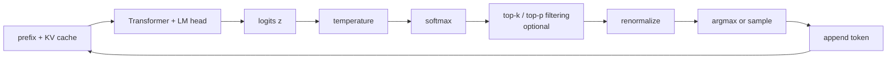

# Decoding Strategies: Greedy, Temperature, Top-k, Top-p, and Beam Search

The [KV-cache note](/posts/ml/2026-11-10-4-kv-cache-making-autoregressive-generation-practical) made the generation loop practical: prefill the prompt, keep each layer's keys and values, and run only the newest token through the model at every decode step. But it deliberately skipped the final decision in that loop.

After the final Transformer layer and language-model head, we have one logit per vocabulary token. Which token do we actually put into the answer?

That choice is **decoding**. It is not another layer, and it does not retrain or modify the model. It is a small algorithm wrapped around the forward pass:

```text
prefix → model + KV cache → next-token logits → decoding rule → chosen token
   ↑                                                              │
   └──────────────── append the token ────────────────────────────┘
```

The model supplies a distribution over what might come next. The decoding rule decides how to use that distribution. Greedy decoding always takes the favorite. Sampling draws from it. Temperature changes its sharpness. Top-k and top-p remove part of its tail. Beam search keeps several partial answers instead of committing to one path.

This note builds each of those ideas on one tiny vocabulary and then places them back inside the cached generation loop.

---

## 1. Where decoding sits in the generation loop

Suppose the prompt is:

```text
the cat sat on the
```

The model's final hidden state for `the` passes through the LM head. To keep the arithmetic visible, pretend the vocabulary contains only six tokens, with these logits:

| candidate token | logit $z_i$ |
|---|---:|
| `mat` | 3 |
| `rug` | 2 |
| `floor` | 1 |
| `sofa` | 0 |
| `quantum` | −1 |
| `banana` | −2 |

These numbers are not probabilities. They are unbounded scores whose relative sizes encode the model's preferences. At temperature 1, softmax gives:

| candidate token | probability |
|---|---:|
| `mat` | 0.6337 |
| `rug` | 0.2331 |
| `floor` | 0.0858 |
| `sofa` | 0.0316 |
| `quantum` | 0.0116 |
| `banana` | 0.0043 |

The probabilities sum to 1. Nothing in the training objective says that `mat` **must** come next. It says that, among the examples and patterns the model learned, this is the preferred next-token distribution in this context.

Decoding now has two separate jobs:

1. optionally reshape or truncate this distribution;
2. choose one token according to a deterministic or random rule.

The selected token is appended to the prefix. That new prefix produces a **new distribution** at the next step, and the whole process repeats.



The model is involved in the expensive part. The decoding rule sees only the final logit row; it never inspects attention weights, residual streams, or cached K/V vectors.

---

## 2. Greedy decoding versus sampling

### Greedy: always take the argmax

The simplest rule is:

$$x_t = \arg\max_i z_i$$

In our example, greedy decoding always selects `mat`. Given the same model, prompt, numerical implementation, and stopping conditions, it produces the same answer every time.

This determinism is useful for debugging. If a cached and uncached implementation are both greedy, they should choose the same tokens up to ordinary floating-point differences. It is also useful when diversity is undesirable and the model's most likely continuation is usually appropriate.

But greedy has two different limitations that are easy to conflate:

- **Repeated answers:** asking the same question twice gives the same text.
- **Locally optimal choices:** the highest-probability next token need not lead to the highest-probability complete answer.

The first is sometimes exactly what we want. The second is a genuine search problem, which beam search addresses later.

### Sampling: draw according to the probabilities

Ancestral sampling — the ordinary kind here — chooses token $i$ with probability $p_i$:

$$x_t \sim \operatorname{Categorical}(p_1,\ldots,p_V)$$

In our example, about 63.37% of independent draws at this step select `mat`, 23.31% select `rug`, and so on. Even `banana` remains possible, just unlikely.

Sampling does not ask for the single most probable continuation. It asks for a draw from the distribution the model learned. That distinction explains both its appeal and its failure modes:

- variety can make answers feel less repetitive;
- several valid answers can all appear across runs;
- a low-probability mistake can be selected;
- once selected, that token becomes part of the context, so later probabilities must condition on it.

Sampling is not happening in a vacuum outside the model. Each random choice changes the next forward pass. Diversity and error can therefore compound through the sequence.

A random number generator supplies the draw. Fixing its seed makes a particular sampling run reproducible, but the seed does not turn sampling into greedy decoding: the generator still chooses among tokens according to their probabilities.

---

## 3. Temperature: reshape the whole distribution

The [softmax note](/posts/ml/2026-09-14-3-softmax-and-multiclass-cross-entropy) introduced temperature as a pre-softmax logit scale:

$$p_i(T)=\frac{e^{z_i/T}}{\sum_j e^{z_j/T}},\qquad T>0$$

Dividing by $T$ changes the logit gaps before exponentiation:

- $T<1$ enlarges the gaps and sharpens the distribution;
- $T=1$ leaves ordinary softmax unchanged;
- $T>1$ shrinks the gaps and flattens the distribution.

Here is our six-token distribution at three temperatures, rounded:

| token | $T=0.5$ | $T=1$ | $T=2$ |
|---|---:|---:|---:|
| `mat` | 0.8647 | 0.6337 | 0.4141 |
| `rug` | 0.1170 | 0.2331 | 0.2512 |
| `floor` | 0.0158 | 0.0858 | 0.1523 |
| `sofa` | 0.0021 | 0.0316 | 0.0924 |
| `quantum` | 0.0003 | 0.0116 | 0.0560 |
| `banana` | 0.00004 | 0.0043 | 0.0340 |

At low temperature, `mat` dominates. At high temperature, every candidate receives a larger share relative to the favorite, including the nonsensical tail.

Temperature is often called a creativity knob. That is a useful shorthand, but the mechanism is more precise: **it changes how often lower-ranked tokens are sampled**. Whether the result is creative, incoherent, diverse, or simply wrong depends on what the model placed in those lower ranks.

Three details prevent common confusion:

1. Temperature does not change the token ordering. Multiplying all logits by $1/T$ with positive $T$ leaves the argmax unchanged. Greedy decoding therefore has no meaningful temperature setting.
2. Temperature is applied to **logits before softmax**, not by raising already-computed probabilities to an arbitrary power in a library-specific temperature wrapper.
3. $T=0$ is not a literal floating-point division by zero. APIs that offer "temperature 0" usually mean "use greedy decoding instead of sampling."

Temperature alone does not remove the tail. At any finite $T>0$, every vocabulary token with a finite logit retains nonzero probability. If we want a hard cutoff, we need truncation.

---

## 4. Top-k sampling: keep a fixed shortlist

Top-k adds one rule: sort tokens by probability, retain only the $k$ highest, set every other probability to zero, and renormalize.

With $k=3$, our shortlist is:

```text
mat, rug, floor
```

Their original probabilities sum to:

$$0.6337+0.2331+0.0858=0.9526$$

After renormalizing within the shortlist:

| token | top-3 probability |
|---|---:|
| `mat` | 0.6652 |
| `rug` | 0.2447 |
| `floor` | 0.0900 |

Everything else has probability exactly zero. Sampling now chooses among the three survivors according to these new probabilities.

Renormalization matters. If we simply deleted the tail and sampled from probabilities totaling 0.9526, we would no longer have a valid categorical distribution. Dividing each surviving probability by the surviving mass restores the total of 1 without changing their relative odds.

The extreme settings connect top-k back to the earlier rules:

- $k=1$ leaves only the argmax, so sampling becomes greedy;
- $k=V$ keeps the whole vocabulary, so it adds no truncation.

Top-k is easy to reason about, but a fixed shortlist size does not adapt to the model's uncertainty. Compare two situations:

```text
confident distribution:     0.97, 0.01, 0.005, 0.005, ...
uncertain distribution:     0.24, 0.22, 0.20, 0.18, 0.16
```

In the first, a shortlist of 10 mostly introduces bad alternatives. In the second, a shortlist of 3 discards several nearly equally plausible choices. The same $k$ cannot be right for both. Top-p addresses that mismatch.

---

## 5. Top-p sampling: keep enough tokens to cover a probability mass

Top-p, also called **nucleus sampling**, chooses the smallest highest-probability set whose cumulative probability is at least $p$. Tokens outside that set are removed, and the survivors are renormalized.

Return to the temperature-1 distribution:

```text
token          mat     rug     floor    sofa    quantum   banana
probability   0.6337  0.2331  0.0858   0.0316   0.0116    0.0043
cumulative    0.6337  0.8668  0.9526   0.9841   0.9958    1.0000
```

Now vary $p$:

- $p=0.50$: `mat` alone crosses the threshold, so only `mat` survives.
- $p=0.90`: `mat + rug` reaches only 0.8668, so `floor` is included; the nucleus is three tokens.
- $p=0.96`: even `floor` is not quite enough, so `sofa` is included too.

The token that crosses the threshold is **included**. Otherwise the retained mass could remain below the requested $p$.

This is the central difference:

```text
top-k: fixed NUMBER of candidates, variable probability mass
top-p: fixed probability MASS, variable number of candidates
```

At one step, the nucleus may contain a single token. At another, it may contain hundreds. The set adapts to the shape of each next-token distribution instead of forcing every step through the same-sized shortlist.

A high setting such as $p=1$ performs no truncation. A smaller setting removes more of the tail, but "smaller" does not automatically mean "better": too aggressive a cutoff can discard valid alternatives just as too generous a cutoff can admit nonsense.

### Top-k and top-p do not make tokens more likely in the model's eyes

Filtering changes only the distribution used by the sampler. It does not rerun the Transformer, adjust its logits, or teach it that removed tokens are wrong. At the next position, the model again produces a full distribution over the entire vocabulary, and filtering starts again.

This also means that a token removed at step $t$ is not banned from step $t+1$. The exclusion lasts for one selection only.

---

## 6. The complete local sampler, in plain NumPy

The mechanics so far fit into a small function. This version applies temperature, then optionally intersects a top-k and top-p filter, renormalizes, and samples. Temperature 0 is treated as greedy.

```python
import numpy as np


def softmax(z):
    z = z - z.max()                         # numerical stability
    e = np.exp(z)
    return e / e.sum()


def choose_next(logits, rng, temperature=1.0, k=None, p=None):
    if temperature == 0:
        return int(logits.argmax())

    probs = softmax(logits / temperature)
    order = np.argsort(-probs)              # descending probability
    keep = np.ones(len(probs), dtype=bool)

    if k is not None:
        keep[order[k:]] = False

    if p is not None:
        cumulative = np.cumsum(probs[order])
        cutoff = min(np.searchsorted(cumulative, p) + 1, len(probs))
        keep[order[cutoff:]] = False        # include the token crossing p

    probs[~keep] = 0.0
    probs /= probs.sum()
    return int(rng.choice(len(probs), p=probs))
```

For the six-token example, `choose_next(..., k=3)` samples from the renormalized three-token distribution in section 4. With `p=0.90`, the same three tokens survive. With `p=0.50`, only `mat` survives.

Real libraries offer additional logits processors and may define the order in which several filters are applied. That order can matter: changing the temperature alters cumulative probability mass, and intersecting top-k with top-p can produce a smaller set than either filter alone. For a mental model, use this pipeline:

```text
logits
  → divide by temperature
  → stable softmax
  → optional truncation
  → renormalize survivors
  → sample
```

For actual generation, the returned token ID is appended to the sequence. During cached decoding, that token is the sole new input at the next step. The sampler itself does not need a cache; the Transformer does.

---

## 7. Why greedy can miss the best sequence

Everything so far chooses **one next token** from **one current prefix**. Greedy commits to its favorite immediately. Top-k and top-p change the candidates or their sampling probabilities, but they do not solve the commitment problem.

Suppose a two-token continuation has these illustrative probabilities:

```text
path A: token A1 has p = 0.60, then A2 has p = 0.50
path B: token B1 has p = 0.40, then B2 has p = 0.90
```

The sequence probabilities are:

$$P(A)=0.60\times0.50=0.30$$

$$P(B)=0.40\times0.90=0.36$$

Greedy chooses A1 because $0.60>0.40$. Once it does, path B is gone. Yet path B has the higher probability as a complete two-token sequence.

The issue is not that greedy implemented argmax incorrectly. Its objective was local. Sequence probability is a product of conditional probabilities:

$$P(x_1,\ldots,x_T\mid\text{prompt})
=\prod_{t=1}^{T}P(x_t\mid\text{prompt},x_1,\ldots,x_{t-1})$$

Maximizing each factor separately does not necessarily maximize the product.

In practice, we compare sums of log-probabilities rather than long products of shrinking numbers:

$$\log P(x_1,\ldots,x_T)=\sum_t\log p(x_t\mid x_{<t})$$

This is the same objective, expressed as a sum that is numerically easier to manage.

---

## 8. Beam search: keep several partial answers

Beam search addresses the commitment problem by retaining the best $B$ partial sequences at every step. $B$ is the **beam width**.

For our example with beam width 2:

```text
after token 1:       keep A1 (0.60) and B1 (0.40)

expand both:         A1 A2 (0.30)     B1 B2 (0.36)
                     other continuations compete too

after pruning:       keep the best 2 COMPLETE partial paths so far
```

If these are the only candidates, beam search retains B1 B2 and finds the sequence that greedy missed.

The algorithm is:

1. start with one empty or prompt-only beam;
2. run the model for every active beam and obtain its next-token log-probabilities;
3. expand each beam by its candidate tokens;
4. score each expanded sequence by the sum of its token log-probabilities;
5. retain the best $B$ sequences;
6. repeat until stopping conditions are met, then choose among completed beams.

This is not the same as top-k sampling. Top-k selects a shortlist of **tokens within one distribution** and then samples one. Beam search maintains several **sequence hypotheses**, expands them, and prunes by accumulated sequence score.

### The cost: multiple sequences, multiple cache states

Beam width $B$ multiplies the active forward-pass and KV-cache work by roughly $B$, apart from batching and implementation optimizations. Each beam has a different generated prefix, so it needs its own logical cache state.

When beams are pruned or reordered, their cached keys and values must be pruned or reordered with them. Otherwise a surviving text prefix could attend to the cache of a different hypothesis. This is a classic beam-search implementation bug: the visible tokens and invisible cache no longer describe the same sequence.

### Two practical qualifications

**Raw log-probability favors shorter answers.** Every token adds a non-positive $\log p$, so stopping early can look artificially attractive. Length normalization, often dividing the sequence score by $T^\alpha$, is one common way to reduce that bias in tasks such as translation.

**Highest probability is not always the human favorite.** Beam search can produce generic, repetitive, or bland text because high-model-probability and interesting are not synonyms. It remains useful for more constrained conditional generation, while open-ended chat commonly uses greedy or sampled decoding rather than large beam searches.

---

## 9. Choosing a strategy, and knowing what it cannot fix

There is no universally best setting, because decoding is choosing a trade-off among determinism, diversity, sequence-level search, and computational cost.

| strategy | what it changes | main strength | main risk or cost |
|---|---|---|---|
| greedy | choose argmax each step | deterministic and cheap | local decisions; repetitive answers |
| temperature sampling | sharpness of the distribution | adjustable diversity | high temperature invites the tail |
| top-k | fixed candidate count | simple tail removal | does not adapt to uncertainty |
| top-p | adaptive candidate set | nucleus follows probability mass | threshold can still keep or remove the wrong alternatives for a task |
| beam search | number of retained prefixes | better sequence-level search | more compute/cache; can favor generic text |

A sensible interpretation of common settings is:

- use **greedy** when reproducibility and a single most-likely answer matter;
- use **moderate sampling with truncation** when several valid phrasings are desirable;
- use **beam search** when sequence-level score is a good proxy for output quality and the extra search cost is justified.

These are starting points, not laws. Evaluate them on the task rather than treating one parameter combination as universally correct.

Most importantly, decoding cannot repair everything:

- **It cannot add missing knowledge.** If the correct answer has negligible probability, truncation will not make the model know it.
- **It cannot guarantee truth.** A confidently sampled false statement is still false.
- **It cannot change the training distribution.** It only manipulates the model's existing output distribution at inference.
- **It cannot eliminate repetition by definition.** High-probability loops can remain high-probability under greedy decoding, low temperature, or narrow truncation.
- **It cannot make different runs comparable without controls.** Prompt, model version, seed, stopping rule, and filtering settings all matter when evaluating generated text.

Repetition penalties, frequency penalties, and presence penalties are additional logits processors aimed at some of these behaviors. They modify scores using tokens already generated; they are separate mechanisms from temperature, top-k, and top-p.

Stopping rules are separate too. `<EOS>`, maximum new tokens, stop strings, and tool-call completion conditions decide **when generation ends**, not which distribution produced the last token.

---

## 10. Summary

- A Transformer produces next-token logits. Decoding converts those logits into a chosen token, appends it, and repeats. KV caching accelerates the forward pass but does not alter this choice.
- **Greedy decoding** takes the argmax and is deterministic. **Ancestral sampling** draws according to token probabilities and produces varied runs.
- **Temperature** divides logits before softmax: lower values sharpen, higher values flatten. It does not change the argmax and is not a literal operation at $T=0$.
- **Top-k** retains a fixed number of candidates. **Top-p** retains the smallest candidate set covering a requested probability mass. Both zero the rest and renormalize.
- Filtering applies independently at each generation step. It does not update model weights or permanently ban a token.
- Greedy's locally best tokens need not form the best complete sequence. **Beam search** keeps several prefixes and scores them by accumulated log-probability.
- Beam search needs a consistent KV-cache state per hypothesis and usually costs roughly the beam width in active sequence computation and memory.
- Decoding can reshape and search what the model already knows how to distribute probability over. It cannot guarantee factuality, repair missing knowledge, or substitute for task-level evaluation.

---

## 11. Exercises — reasoning only

1. In the six-token example, which tokens survive top-p with $p=0.85$? What about $p=0.95$? Explain why the answer changes between those thresholds.
2. After top-3 filtering, `mat` rises from probability 0.6337 to 0.6652. Did the model become more confident in `mat`? What exactly changed?
3. Why does temperature leave greedy decoding unchanged at every finite positive $T$, even though it changes ancestral sampling?
4. A distribution is $(0.50,0.20,0.15,0.10,0.05)$. Compute the top-2 renormalized distribution and the top-p nucleus at $p=0.80$.
5. Why can top-k = 5 be too permissive at one generation step and too restrictive at another? Use the shape of the distribution in your answer.
6. Greedy picks a token with probability 0.7, after which the best continuation has probability 0.2. Another first token has probability 0.3, followed by a token with probability 0.9. Compare the two sequence probabilities and explain greedy's mistake.
7. A beam-search implementation keeps the correct text prefixes but produces nonsense after the first pruning step. Its KV cache was not reordered when the beams were pruned. Explain the mismatch.
8. Why would setting top-p to 0.5 at one step not permanently restrict the model to its top 50% probability mass for the entire answer?
9. A user raises temperature from 0.7 to 1.4 to make a factual question-answering system more accurate. Explain why this is aiming the knob at the wrong problem.
10. Beam width 4 and top-k = 4 both contain the number 4. Describe what each number limits and why the algorithms are not interchangeable.

---

## 12. What comes next

Decoding strategies choose **which token** to accept. A different inference idea asks whether we can avoid running the full model separately for every accepted token without changing the resulting distribution.

That leads to **speculative decoding**: let a cheaper draft model propose several tokens, then use the target model to verify them in parallel. It connects the serial decode loop from the KV-cache note with a precise acceptance rule designed to preserve the target model's output distribution.
