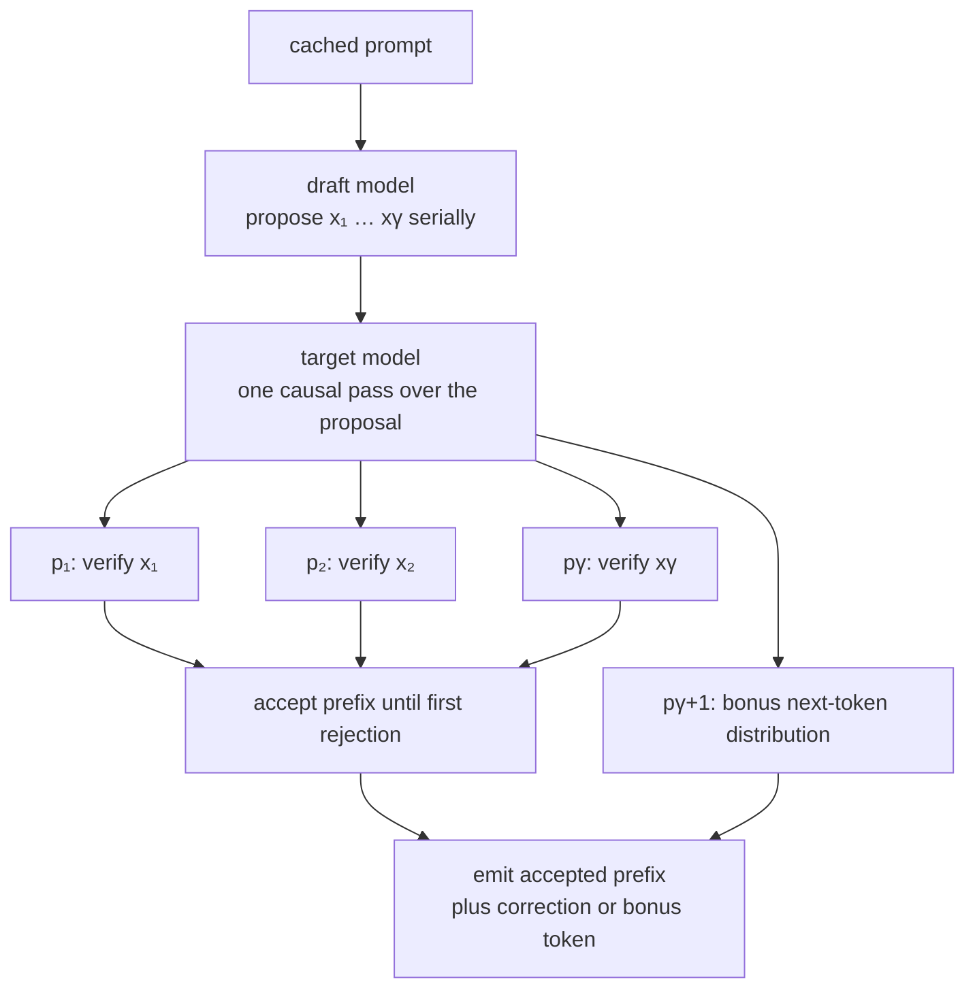

# Speculative Decoding: Verifying Several Tokens in Parallel

The [decoding-strategies note](/posts/ml/2026-11-21-5-decoding-strategies-from-logits-to-a-generated-answer) answered which token to choose from a next-token distribution. It did not remove the central inefficiency of generation: every accepted token normally requires another serial step through the large target model.

KV caching makes each of those steps cheaper by reusing old keys and values. But the loop is still serial:

```text
target model → token 1 → target model → token 2 → target model → token 3
```

**Speculative decoding** adds a second, cheaper model called the **draft model**. The draft proposes several tokens serially. The large target model then examines the whole proposed suffix in one parallel forward pass and decides what to accept.

```text
cheap draft:      x₁ → x₂ → x₃ → x₄       several small serial steps
                         │
                         ▼
large target:     verify [x₁, x₂, x₃, x₄] together
                         │
                         ▼
             accept a prefix, correct the first mistake,
             and discard everything after it
```

The surprising part is not that a small model can make useful suggestions. It is that, with the right acceptance and rejection rule, **sampling can remain exactly faithful to the large model's distribution**. The draft changes how quickly tokens are produced, not which distribution produced them.

---

## 1. The bottleneck we are attacking

During ordinary cached decode, the target model processes one new token per step. That token passes through every Transformer layer. Its query attends to the cached keys and values, the FFN runs, and the LM head produces the next distribution.

This creates two related costs:

1. the large model must run once per generated token;
2. each run is small and serial, so it can be difficult to keep a large GPU fully occupied.

Processing several tokens in parallel sounds impossible at first. The input to step $t+1$ is the token chosen at step $t$, and we do not know that token until the step finishes.

Speculative decoding resolves the dependency by **guessing**. Once a complete candidate suffix exists, the target can evaluate every candidate position with causal masking, just as teacher forcing evaluates every known target token during training.

The guesses do not have to be perfect. They only have to be good enough, often enough, to repay the draft model's cost.

---

## 2. Two models, one vocabulary

Call the models:

- **target:** the large model whose output we want;
- **draft:** a smaller, faster model whose suggestions accelerate the target.

They can have different widths, depths, and architectures. In the standard algorithm, they must share a tokenizer and vocabulary, because we compare their probabilities for the same proposed token IDs.

For a given prefix, write:

$$p(\cdot\mid\text{prefix}) \quad\text{for the target distribution}$$

$$q(\cdot\mid\text{prefix}) \quad\text{for the draft distribution}$$

Ideally, $q$ is both cheap to compute and close to $p$. Those goals pull against each other: a tiny draft is fast but may propose poorly; a nearly target-sized draft may propose well but erase the speedup.

The target remains the authority. The draft never earns the right to change the final distribution merely by being confident.

---

## 3. One speculative round

Choose a proposal length $\gamma$, such as 4. One round has two phases.

### Phase A: draft proposes $\gamma$ tokens

The draft runs autoregressively, just like ordinary generation:

```text
prefix       → q₁ → propose x₁
prefix, x₁   → q₂ → propose x₂
prefix, x₁,x₂→ q₃ → propose x₃
...
```

For sampled speculative decoding, $x_i$ is drawn from the draft distribution $q_i$. For greedy speculative decoding, it is the draft's argmax. These draft steps are still serial, but each is comparatively cheap.

### Phase B: target verifies the proposed suffix

The target evaluates the proposed tokens together and obtains the relevant next-token distributions:

$$p_1,p_2,\ldots,p_{\gamma+1}$$

Here $p_i$ is the target distribution at the position where draft token $x_i$ was proposed. The final distribution $p_{\gamma+1}$ is useful when every proposal is accepted: it supplies one additional token.

The target then walks through the proposals in order:

- accept $x_1$, or stop and correct it;
- if accepted, test $x_2$ against the target distribution conditioned on $x_1$;
- continue until the first rejection or until all $\gamma$ tokens survive.

A rejection invalidates the rejected token **and every later proposal**, because those later draft distributions were conditioned on a prefix that will no longer exist.

Every round makes progress:

- a rejection produces a replacement token from the target-side rule;
- complete acceptance allows one extra token from $p_{\gamma+1}$.

Therefore one target verification yields between 1 and $\gamma+1$ output tokens.

---

## 4. Why the target can verify in parallel

Suppose the prompt cache is warm and the draft proposes:

```text
x₁ = on
x₂ = the
x₃ = mat
x₄ = .
```

The target receives this known candidate suffix in one pass. Causal masking preserves the correct dependencies:

```text
position of x₁: sees prompt
position of x₂: sees prompt + x₁
position of x₃: sees prompt + x₁ + x₂
position of x₄: sees prompt + x₁ + x₂ + x₃
```

The output distributions needed for verification line up as follows:

```text
target output after prompt  → p₁, used to test x₁
target output after x₁      → p₂, used to test x₂
target output after x₂      → p₃, used to test x₃
target output after x₃      → p₄, used to test x₄
target output after x₄      → p₅, used for an extra token if all are accepted
```

No candidate needs to be the model's actual generated output for this computation to work. It is simply a known token sequence being scored conditionally at every position.

This is the same information pattern as teacher-forced training. The difference is that we are not calculating a loss or gradients. We are comparing draft choices with target distributions.



The parallel pass does not mean the target does no work for rejected tokens. It scores the whole proposal, including positions that may later be discarded. Speculative decoding wins by replacing serial target steps with better-utilized parallel work, not by making target computation free.

---

## 5. The exact acceptance rule for sampling

Greedy verification is easy to state; sampled verification needs more care.

Suppose the draft proposed token $x$ from distribution $q$, and the target distribution at the same position is $p$. Accept the proposal with probability:

$$\alpha(x)=\min\left(1,\frac{p(x)}{q(x)}\right)$$

Draw $u\sim\operatorname{Uniform}[0,1]$:

- if $u\leq\alpha(x)$, accept $x$;
- otherwise reject it and sample a replacement from the **residual distribution**:

$$p'(v)=\frac{\max(0,p(v)-q(v))}
{\sum_w\max(0,p(w)-q(w))}$$

In notation, define $[p-q]_+(v)=\max(0,p(v)-q(v))$. Then the rejection distribution is simply the normalized positive part of $p-q$.

This rule has two intuitive regimes:

- **target likes the token at least as much as draft:** $p(x)\geq q(x)$, so acceptance probability is 1;
- **draft overproposes the token relative to target:** $p(x)<q(x)$, so acceptance probability is $p(x)/q(x)<1$.

The second case removes exactly the draft's excess probability mass. Rejection then redistributes that mass toward tokens the draft underproposed.

A naive rule such as "accept whenever the target assigns a reasonably high probability" is not enough. It may produce fluent text, but it generally changes the target distribution.

---

## 6. A numerical example: a biased draft, an exact result

Let the vocabulary be $\{A,B,C\}$. At one position:

$$p=(0.50,0.30,0.20)$$

$$q=(0.20,0.40,0.40)$$

The draft underproposes A and overproposes B and C. Its acceptance probabilities are:

| token | $p(x)$ | $q(x)$ | $\min(1,p/q)$ |
|---|---:|---:|---:|
| A | 0.50 | 0.20 | 1.00 |
| B | 0.30 | 0.40 | 0.75 |
| C | 0.20 | 0.40 | 0.50 |

Now account for how often each token was proposed and then accepted:

$$q(x)\min\left(1,\frac{p(x)}{q(x)}\right)=\min(q(x),p(x))$$

| token | accepted proposal mass |
|---|---:|
| A | 0.20 |
| B | 0.30 |
| C | 0.20 |

The total accepted mass is $0.70$, so the probability of reaching rejection is $0.30$.

For the residual distribution, only A has a positive value of $p-q$:

$$[p-q]_+=(0.30,0,0)$$

Normalizing by its total mass 0.30 gives:

$$p'=(1,0,0)$$

So rejection always corrects the outcome to A in this example. The final probability of A is:

$$\underbrace{0.20}_{\text{proposed and accepted}}
+\underbrace{0.30\times1}_{\text{rejection path}}=0.50$$

The final probabilities of B and C are their accepted proposal masses, 0.30 and 0.20. The result is exactly:

$$(0.50,0.30,0.20)=p$$

The draft was noticeably different from the target, yet the final distribution did not inherit that bias.

---

## 7. Why the algebra works

The numerical example is one line of algebra away from the general proof.

For any token $v$, there are two disjoint ways for it to become the output.

**Path 1: draft proposes $v$, and it is accepted.** This contributes:

$$q(v)\min\left(1,\frac{p(v)}{q(v)}\right)=\min(q(v),p(v))$$

**Path 2: any proposal is rejected, and the residual sampler chooses $v$.**

First, the total rejection probability is:

$$R=1-\sum_w\min(q(w),p(w))
=\sum_w\left[q(w)-\min(q(w),p(w))\right]$$

The term in brackets is $[q-p]_+(w)$. Because $p$ and $q$ both sum to 1, the positive and negative parts of their difference have equal total mass:

$$\sum_w[q(w)-p(w)]_+
=\sum_w[p(w)-q(w)]_+$$

Therefore the rejection path contributes:

$$R\frac{[p(v)-q(v)]_+}{R}=[p(v)-q(v)]_+$$

Adding the two paths:

$$\min(q(v),p(v))+[p(v)-q(v)]_+=p(v)$$

That is the whole correctness argument for one token.

If $p=q$, then every proposed token has acceptance probability 1 and the residual mass is zero. There is no rejection path, so the otherwise worrying $0/0$ normalization never occurs.

For a multi-token proposal, the same argument applies conditionally at each position. The first accepted or corrected token has the right target distribution; conditioned on that prefix, the next one does too. The chain rule then gives the correct target joint distribution over the emitted sequence.

---

## 8. The complete sampled algorithm

Here is the round from section 3 with the exact rule filled in:

```text
start with a prompt and initialized draft/target KV caches

repeat until stopping:
    # 1. Draft phase
    for i = 1 … γ:
        compute draft distribution qᵢ
        sample xᵢ ~ qᵢ
        append xᵢ to the draft's proposal state

    # 2. Target verification in parallel
    compute p₁ … pγ and pγ₊₁ for the proposed suffix

    # 3. Sequential accept/reject decisions (cheap scalar work)
    for i = 1 … γ:
        u ~ Uniform(0, 1)
        if u ≤ min(1, pᵢ(xᵢ) / qᵢ(xᵢ)):
            emit xᵢ
        else:
            residual = max(pᵢ - qᵢ, 0)
            emit one sample from residual / residual.sum()
            discard proposal and target-cache entries from position i onward
            break

    if all γ proposals were accepted:
        emit one sample from pγ₊₁

    retain cache states only for the emitted, valid prefix
```

The accept/reject loop is sequential, but it operates on a handful of probabilities. The expensive target tensor computation has already happened in parallel.

Two implementation details are easy to miss:

- $p_i$ and $q_i$ must be the actual target and draft distributions used for that decision, including whatever temperature or probability processing the algorithm specifies.
- On rejection, the later proposals are not merely hidden from the text. Their cache entries must be removed too.

Exactness is always relative to the target distribution $p$ used by the verification rule. If an application applies top-p or another transformation before defining $p$, speculative decoding can preserve that processed distribution only if the implementation consistently uses the processed probabilities in the acceptance algebra.

---

## 9. Greedy speculative decoding is the simpler special case

If the desired output is the target's greedy sequence, there is no residual sampling rule to manage.

For each proposed token:

```text
if xᵢ == argmax(pᵢ):
    accept xᵢ
else:
    emit argmax(pᵢ) as the correction
    discard xᵢ and every later proposal
    stop this round
```

If every proposal matches, emit one extra greedy token from $p_{\gamma+1}$.

The final text is exactly what ordinary greedy target decoding would have produced, because every accepted token was checked against the target's own argmax under the same accepted prefix.

This also clarifies why verification order matters. We cannot accept $x_3$ merely because it is the target's favorite conditioned on the draft's earlier tokens if $x_2$ was already rejected. Once $x_2$ changes, the prefix for position 3 changes, and the old $p_3$ is no longer relevant.

---

## 10. What happens to the KV cache?

Speculative decoding and KV caching fit together naturally, but the cache now has a draft/target and accepted/provisional structure.

### Draft side

The draft generates proposals autoregressively, so it appends K/V entries for each proposed token as usual. If proposal $x_i$ is rejected, draft entries from $i$ onward belong to an abandoned suffix and must be discarded.

### Target side

The target's verification pass computes K/V entries for the proposed tokens at every layer. Entries for the accepted prefix can remain. Entries for the rejected token and later proposals must be removed.

If all proposals are accepted, the target cache already contains their K/V entries. The bonus token sampled from $p_{\gamma+1}$ has been chosen but has not itself been processed yet; its cache entries will be created when it is fed into a subsequent forward pass.

The same applies to a correction sampled after rejection: emitting the token does not automatically compute its K/V projections.

```text
draft proposal:       x₁   x₂   x₃   x₄
decision:            ✓    ✓    ✗    abandoned

valid target cache:  x₁   x₂
cache to discard:               x₃   x₄

emitted correction:              r₃   ← not processed into cache yet
```

A useful invariant is:

**At the start of the next round, every cache entry must belong to the actual emitted prefix, and every emitted token that needs future conditioning must eventually receive its own forward computation.**

Many speculative-decoding bugs are cache-accounting bugs rather than acceptance-rule bugs. The text may look correct while later tokens attend to stale keys and values from an abandoned draft branch.

---

## 11. When is it actually faster?

A rough latency model makes the trade-off visible. Let:

- $C_d$ be the cost of one draft decode step;
- $C_t(\gamma)$ be the cost of one target verification over $\gamma$ proposed positions;
- $A_\gamma$ be the expected number of output tokens emitted per speculative round.

Then the approximate average cost per emitted token is:

$$\frac{\gamma C_d+C_t(\gamma)}{A_\gamma}$$

Ordinary target decoding costs roughly $C_t(1)$ per token. Speculation helps when the draft steps and parallel verification produce more target-equivalent progress per unit time than that baseline.

Several quantities matter at once:

### Draft quality

Better agreement between $q$ and $p$ increases acceptance. But acceptance rate alone is not a complete speed metric: a slow, accurate draft can lose to a fast, slightly worse one.

### Draft cost

The draft still generates its $\gamma$ proposals serially. Its model weights, activations, and KV cache also consume memory and memory bandwidth.

### Proposal length $\gamma$

A longer proposal offers more possible tokens per target call. It also costs more draft steps, more target verification work, and usually more wasted suffix computation after a mismatch. Increasing $\gamma$ is not monotonically better.

### Target hardware utilization

Speculation is most attractive when one-token target decode underuses the accelerator and verifying several positions in parallel is comparatively efficient. At large serving batches, the GPU may already be well utilized, so the benefit can shrink.

### Acceptance position, not just average agreement

Agreement on late proposal tokens is valuable only if the earlier tokens survive. A single early rejection discards the whole remaining suffix.

The honest evaluation is end-to-end latency on the actual model pair, hardware, prompt lengths, and serving workload. "The draft matches the target 80% of the time" is not enough to predict speedup.

---

## 12. What "exact" does and does not mean

The exactness claim is important enough to bound carefully.

### It means: the target distribution is preserved

With correct sampled acceptance and residual rejection, the emitted token at each position has distribution $p$, not $q$ and not some unspecified blend. With greedy verification, the emitted sequence follows the target's greedy path.

No model weights are modified, and no approximation is inherently required by the algorithm.

### It does not mean: the draft is irrelevant to latency

A poor draft can produce frequent early rejections and substantial wasted work. Exact output and slow output are perfectly compatible.

### It does not mean: every random seed gives the same text as ordinary sampling

Preserving a distribution is not the same as reproducing one particular random trajectory. A speculative sampler and an ordinary sampler can both be correct while consuming random numbers differently and producing different text for the same nominal seed.

Greedy decoding is different: there is no sampling trajectory to diverge, so exact verification should reproduce the target's greedy tokens up to numerical implementation differences.

### It does not mean: verification is free

The target still evaluates the proposal, including abandoned positions. Speculation exchanges serial target calls for parallel verification and extra draft work; it does not eliminate the target forward pass.

### It does not mean: any draft-token acceptance heuristic is exact

The ratio test and residual distribution are doing real mathematical work. Simply accepting the longest prefix that "looks good" to the target generally produces a different distribution.

### It does not mean: the target learns from the draft

There is no gradient, distillation loss, or weight update. This is inference-time cooperation. Knowledge distillation can be used separately to train a good draft, but it is not what makes speculative decoding exact.

---

## 13. Related ideas, once the core algorithm is clear

Several methods share the broad goal of producing or validating more than one token at a time, but change where the proposals come from:

- **Self-speculative decoding:** part of the target model, or an early-exit version of it, acts as the draft. This avoids shipping an entirely separate draft model.
- **Medusa:** adds extra prediction heads to propose tokens at multiple future positions rather than relying only on a separate autoregressive draft model.
- **EAGLE:** drafts in the target model's feature space and reuses target representations to make high-quality proposals.
- **Speculative sampling for other generators:** the accept/reject principle appears beyond ordinary text whenever a cheap proposal distribution and a more expensive target distribution can be evaluated.

These are not interchangeable implementation details. They change the proposal mechanism, cache behavior, and engineering trade-offs. The acceptance logic from this note is the foundation for reading them without reducing everything to "small model helps big model."

---

## 14. Summary

- Autoregressive decoding is serial because each next input token depends on the previous choice. KV caching removes redundant old-token computation but leaves that serial loop intact.
- Speculative decoding uses a cheap draft model to propose $\gamma$ tokens, then verifies the whole suffix with the target in one causal, parallel pass.
- The target produces distributions for every proposal position plus one bonus position. Verification accepts a valid prefix and discards everything after the first rejection.
- For exact sampling, accept a proposed token with probability $\min(1,p/q)$. On rejection, sample from the normalized residual $[p-q]_+$.
- The accepted proposal mass is $\min(p,q)$; the rejection path adds $[p-q]_+$. Their sum is exactly $p$.
- Greedy speculation accepts only draft tokens matching the target argmax and corrects the first mismatch, preserving the target's greedy output.
- Draft and target KV caches must be truncated to the accepted prefix. Correction and bonus tokens still need their own later forward computation.
- Speed depends on draft quality, draft cost, proposal length, acceptance positions, hardware utilization, and serving batch size. Exactness does not guarantee a speedup.
- The target model and its output distribution remain authoritative. The draft changes the execution strategy, not the model being served.

---

## 15. Exercises — reasoning only

1. Why can the target evaluate draft tokens in parallel even though ordinary generation must choose tokens serially? Connect your answer to causal masking and teacher forcing.
2. At one position, $p=(0.60,0.25,0.15)$ and $q=(0.30,0.50,0.20)$. Compute the acceptance probability for each proposed token and the total probability of rejection.
3. Continuing exercise 2, compute the residual rejection distribution and show that each token's final probability equals its target probability.
4. Why is "accept a draft token whenever $p(x)>0.2$" not guaranteed to preserve the target distribution?
5. A draft proposes four tokens. The third is rejected. Why must the fourth be discarded even if the target assigned it a high conditional probability under the draft prefix?
6. In greedy speculation, the first two draft tokens match the target and the third does not. What text is emitted, and which target-cache entries survive?
7. After all four proposals are accepted, we sample a bonus token from $p_5$. Why is that bonus token not already present in the target KV cache?
8. Why can a high average draft/target agreement still produce little speedup? Give two different explanations.
9. What is the difference between saying two samplers have the same output distribution and saying they produce the same text for one random seed?
10. Suppose $\gamma$ is made extremely large. List the costs that grow and explain why expected tokens per target call cannot keep improving indefinitely.
11. A draft and target use different tokenizers. Why does the standard $p(x)/q(x)$ comparison no longer have a straightforward meaning?
12. Is speculative decoding closer to KV caching or knowledge distillation in its effect on the target model? Explain which parts are execution-time mechanisms and which would change learned weights.

---

## 16. What comes next

So far, the inference notes have followed one request: cache its past, choose its next token, and accelerate its serial decode with speculation. A serving system rarely handles one request at a time, though.

The next systems note is **continuous batching**: how many requests with different prompt lengths, decode progress, cache sizes, and finishing times share the same GPU without making every request wait for the slowest fixed batch.

**Reading:**

- Leviathan, Kalman & Matias, [*Fast Inference from Transformers via Speculative Decoding*](https://arxiv.org/abs/2211.17192) (2022/ICML 2023) — the exact acceptance rule and multi-token verification algorithm.
- Chen et al., [*Accelerating Large Language Model Decoding with Speculative Sampling*](https://arxiv.org/abs/2302.01318) (2023) — another clear presentation of speculative sampling and its practical trade-offs.
