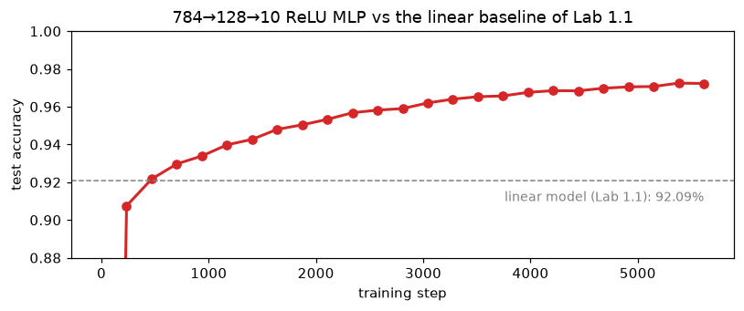
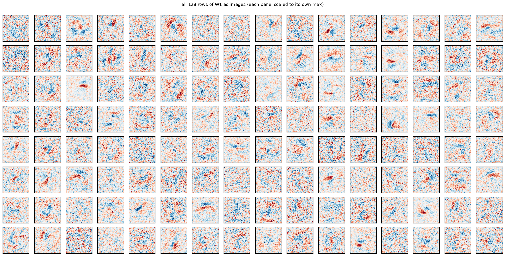
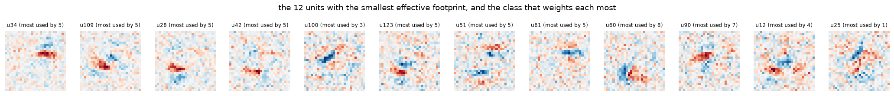
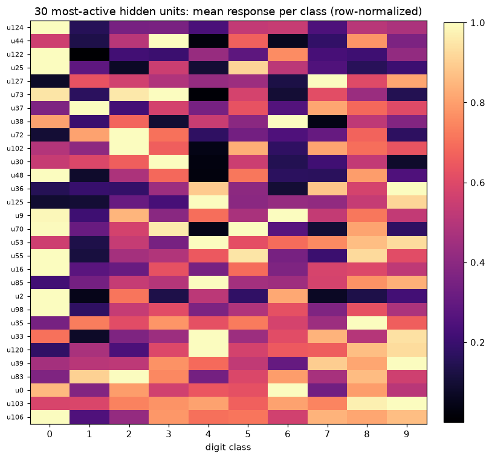
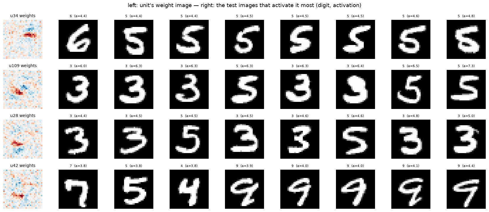
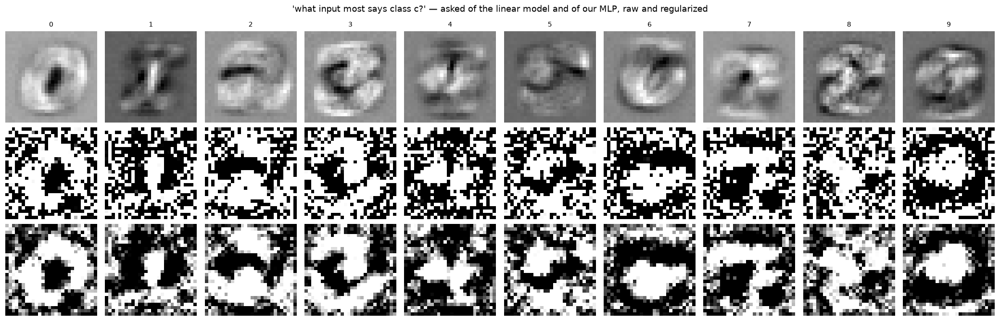
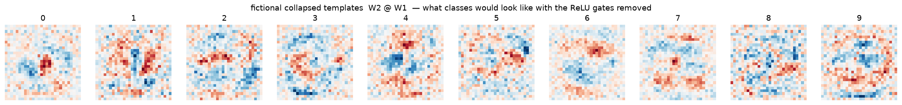
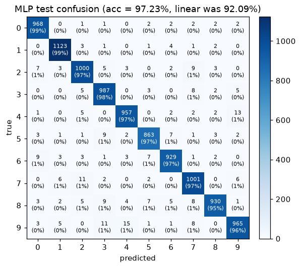

# Lab 1.3: From Templates to Features — What One Hidden Layer Does to the Weights

**MNIST internals series.** [Lab 1.1](/posts/ml/labs/2026-10-19-lab-1-mnist-from-pixels-to-neural-network/) gave us the clean answer: in a linear softmax model, a weight row is a matched-filter photograph of its class. [Lab 1.2](/posts/ml/labs/2026-10-19-lab-2-continual-learning-1-2-then-3/) showed those photographs being painted, re-carved, and out-bid.

Now the question this series was really building toward: **add one hidden layer. What happens to the weight picture?**

If you've watched 3Blue1Brown's neural nets series, you might expect: "layers learn edges, then curves, then parts; visualizing raw weights won't tell you much here." We can now test that ourselves instead of taking it on faith, and the truth lands in a more interesting place:

1. **First-layer weights stay visualizable** — they still live in pixel space. But what they show changes completely: not classes, but *parts*. You will see the "edgelets and stroke fragments" with your own eyes by the end of §3.
2. **The second layer is where visualization truly dies** — 128 hidden activations don't reshape into any image. There, class knowledge dissolves into *routing coefficients over parts*, and we need new instruments: dataset search ("what makes this neuron fire?") and **activation maximization** — the Distill tool, built from scratch.
3. Along the way: lesion studies (causal, not just correlational), "dreams" of each digit class, and a measurement of why the 92% confusions from Lab 1.1 get fixed.

Everything is still float64 NumPy, backprop written by hand and verified numerically before we trust a single picture.

## 0. Setup

Architecture: $784 \to 128 \;(\mathrm{ReLU}) \to 10 \;(\mathrm{softmax})$. Same data, same training ritual, checkpoints every epoch as before.

```python
from pathlib import Path
import sys, time
import numpy as np
import matplotlib.pyplot as plt

%matplotlib inline
plt.rcParams["figure.dpi"] = 110

from mnist_lab import (load_mnist, one_hot, show_grid, show_confusion,
                       save_fig, save_ckpt, load_ckpt, manifest)

rng = np.random.default_rng(3)
x_train, y_train, x_test, y_test = load_mnist("data")
CKPT = Path("checkpoints/lab03"); FIGS = Path("figures/lab03"); FIGS.mkdir(parents=True, exist_ok=True)
print("python:", sys.version.split()[0], "| numpy:", np.__version__, "| data:", x_train.shape, x_test.shape)
```

    python: 3.14.3 | numpy: 2.5.4 | data: (60000, 784) (10000, 784)


## 1. The model, and its gradients on paper first

**Forward:**
$$z_1 = xW_1^\top + b_1 \qquad a_1 = \max(z_1, 0) \qquad z_2 = a_1W_2^\top + b_2 \qquad \hat p = \mathrm{softmax}(z_2)$$

The loss $\mathcal{L}$ is a single number measuring how wrong the predictions are. For one image, cross-entropy is $\ell_i = -\sum_c y_{i,c}\log(\hat p_{i,c})$; since $y_i$ is one-hot, this is just minus the log-probability assigned to the correct class. For a batch of $N$ images, we average those losses:

$$\mathcal{L} = \frac{1}{N}\sum_{i=1}^{N}\ell_i = -\frac{1}{N}\sum_{i=1}^{N}\sum_{c=1}^{C} y_{i,c}\log(\hat p_{i,c})$$

**Backward** (chain rule, exactly the dense-network derivation from the [backprop notes](/posts/ml/2026-09-12-3-backpropagation-in-a-fully-connected-network) — written out because every claim in this lab depends on it):

$$\delta_2 = \tfrac1N (\hat p - y) \qquad \frac{\partial \mathcal{L}}{\partial W_2} = \delta_2^\top a_1 \qquad \delta_1 = (\delta_2 W_2) \odot \mathbb{1}[z_1 > 0] \qquad \frac{\partial \mathcal{L}}{\partial W_1} = \delta_1^\top x$$

To read the hidden-layer error $\delta_1$, follow two steps: $\delta_2 W_2$ passes the output error signal backward through $W_2$, estimating how much each hidden unit contributed. Then $\mathbb{1}[z_1>0]$ gates that signal: it is 1 for a hidden unit whose ReLU was active and 0 for one whose output was shut off. The symbol $\odot$ means multiply corresponding entries element by element. So inactive units get no error signal for this step.

This is the piece that is new relative to Lab 1.1: information flowing into a first-layer weight is routed through $W_2$ and gated by the ReLU mask. A first-layer row no longer learns "what class $c$ looks like" — it learns *"something the assembler layer finds useful to talk about."* Remember that sentence when we look at the pictures.

> No need to make sense of backprop formulas all over again, just need to remember gradients flow backwards - if prediction is right then nothing flows back, if neuron is not activated, then also nothing flows back.

```python
class MLP:
    """784 -> n_hidden (ReLU) -> 10 (softmax, cross-entropy). Plain SGD, float64."""
    def __init__(self, n_in, n_hidden, n_classes, rng):
        self.W1 = rng.normal(0, np.sqrt(2.0 / n_in), size=(n_hidden, n_in))   # He init for ReLU
        self.b1 = np.zeros(n_hidden)
        self.W2 = rng.normal(0, np.sqrt(2.0 / n_hidden), size=(n_classes, n_hidden))
        self.b2 = np.zeros(n_classes)

    def forward(self, x):
        z1 = x @ self.W1.T + self.b1
        a1 = np.maximum(z1, 0)
        z2 = a1 @ self.W2.T + self.b2
        return z1, a1, z2

    def probs(self, x):
        _, _, z2 = self.forward(x)
        z2 = z2 - z2.max(axis=1, keepdims=True)
        e = np.exp(z2)
        return e / e.sum(axis=1, keepdims=True)

    def loss(self, x, y):
        p = self.probs(x)
        return float(-np.log(p[np.arange(len(y)), y] + 1e-12).mean())

    def grad(self, x, y):
        z1, a1, _ = self.forward(x)
        p = self.probs(x)
        d2 = (p - one_hot(y, self.W2.shape[0])) / len(y)
        gW2, gb2 = d2.T @ a1, d2.sum(axis=0)
        d1 = (d2 @ self.W2) * (z1 > 0)          # routed through W2, gated by ReLU mask
        gW1, gb1 = d1.T @ x, d1.sum(axis=0)
        return gW1, gb1, gW2, gb2

    def step(self, x, y, lr):
        gW1, gb1, gW2, gb2 = self.grad(x, y)
        self.W1 -= lr * gW1; self.b1 -= lr * gb1
        self.W2 -= lr * gW2; self.b2 -= lr * gb2

    def predict(self, x):    return self.forward(x)[2].argmax(axis=1)
    def accuracy(self, x, y): return float((self.predict(x) == y).mean())

print(f"parameters: {128*784 + 128 + 10*128 + 10:,}  (vs 7,860 for Lab 1.1's linear model)")
```

    parameters: 101,770  (vs 7,860 for Lab 1.1's linear model)


```python
xt, yt = x_train[:8].astype(np.float64), y_train[:8]
probe = MLP(784, 128, 10, np.random.default_rng(0))
gW1, gb1, gW2, gb2 = probe.grad(xt, yt)

eps, errs = 1e-6, []
def check(param, grad, idx):
    orig = param[idx]
    param[idx] = orig + eps; lp = probe.loss(xt, yt)
    param[idx] = orig - eps; lm = probe.loss(xt, yt)
    param[idx] = orig
    errs.append(abs(grad[idx] - (lp - lm) / (2 * eps)) / (1e-12 + abs(grad[idx]) + abs((lp - lm) / (2 * eps))))

r = np.random.default_rng(1)
for _ in range(12): check(probe.W1, gW1, tuple(r.integers(0, s) for s in probe.W1.shape))
for _ in range(12): check(probe.W2, gW2, tuple(r.integers(0, s) for s in probe.W2.shape))
for _ in range(4):  check(probe.b1, gb1, tuple([r.integers(0, 128)]))
for _ in range(4):  check(probe.b2, gb2, tuple([r.integers(0, 10)]))
print(f"max relative error over {len(errs)} probed parameters (all four tensors): {max(errs):.2e}")
```

    max relative error over 32 probed parameters (all four tensors): 5.25e-08


## 2. Training

Same SGD ritual as before: batch 256, lr 0.1, 8 epochs, checkpoint at every epoch boundary. The comparison that matters: Lab 1.1's linear model plateaued at **92.09%**. Everything past that number, whatever it is, was bought by the hidden layer — and it is the hidden layer's internals we're here to open.

```python
BATCH, LR, EPOCHS = 256, 0.1, 24
model = MLP(784, 128, 10, rng)
hist, snaps = [(0, model.accuracy(x_test, y_test), model.loss(x_train[::25], y_train[::25]))], {}
save_ckpt(CKPT, "epoch_0", step=0, metrics={"test_acc": round(model.accuracy(x_test, y_test), 4)},
          W1=model.W1, b1=model.b1, W2=model.W2, b2=model.b2)

t0, step = time.perf_counter(), 0
for epoch in range(1, EPOCHS + 1):
    perm = rng.permutation(len(x_train))
    perm = perm[: len(perm) // BATCH * BATCH]
    for i in perm.reshape(-1, BATCH):
        model.step(x_train[i], y_train[i], LR); step += 1
    acc, loss = model.accuracy(x_test, y_test), model.loss(x_train[::25], y_train[::25])
    hist.append((step, acc, loss)); snaps[epoch] = model.W1.copy()
    save_ckpt(CKPT, f"epoch_{epoch}", step=step, metrics={"test_acc": round(acc, 4), "loss": round(loss, 4)},
              W1=model.W1, b1=model.b1, W2=model.W2, b2=model.b2)
    print(f"epoch {epoch}: test acc = {acc:.4f}  loss = {loss:.4f}")

final_acc = model.accuracy(x_test, y_test)
print(f"\n{step} steps in {time.perf_counter() - t0:.0f}s | final: {final_acc:.4f}  (linear model from Lab 1.1: 0.9209)")

h = np.array(hist)
fig, ax = plt.subplots(figsize=(7.5, 3.2))
ax.plot(h[:, 0], h[:, 1], "o-", color="tab:red", lw=2)
ax.axhline(0.9209, color="grey", ls="--", lw=1)
ax.text(step, 0.91, "linear model (Lab 1.1): 92.09%", ha="right", fontsize=9, color="grey")
ax.set_xlabel("training step"); ax.set_ylabel("test accuracy"); ax.set_ylim(0.88, 1.0)
ax.set_title("784→128→10 ReLU MLP vs the linear baseline of Lab 1.1")
fig.tight_layout(); save_fig(fig, FIGS / "training_curve.png"); plt.show()
```

    epoch 1: test acc = 0.9075  loss = 0.3277


    epoch 2: test acc = 0.9217  loss = 0.2679


    epoch 3: test acc = 0.9297  loss = 0.2328


    epoch 4: test acc = 0.9339  loss = 0.2124


    epoch 5: test acc = 0.9398  loss = 0.1924


    epoch 6: test acc = 0.9427  loss = 0.1760


    epoch 7: test acc = 0.9480  loss = 0.1584


    epoch 8: test acc = 0.9504  loss = 0.1499


    epoch 9: test acc = 0.9533  loss = 0.1377


    epoch 10: test acc = 0.9568  loss = 0.1304


    epoch 11: test acc = 0.9582  loss = 0.1226


    epoch 12: test acc = 0.9590  loss = 0.1149


    epoch 13: test acc = 0.9620  loss = 0.1119


    epoch 14: test acc = 0.9640  loss = 0.1044


    epoch 15: test acc = 0.9653  loss = 0.1002


    epoch 16: test acc = 0.9657  loss = 0.0972


    epoch 17: test acc = 0.9676  loss = 0.0926


    epoch 18: test acc = 0.9685  loss = 0.0888


    epoch 19: test acc = 0.9684  loss = 0.0867


    epoch 20: test acc = 0.9698  loss = 0.0810


    epoch 21: test acc = 0.9705  loss = 0.0802


    epoch 22: test acc = 0.9707  loss = 0.0772


    epoch 23: test acc = 0.9725  loss = 0.0752


    epoch 24: test acc = 0.9723  loss = 0.0719
    
    5616 steps in 7s | final: 0.9723  (linear model from Lab 1.1: 0.9209)
    saved figure -> figures/lab03/training_curve.png


    

    


## 3. The brute-force test: just plot all of $W_1$ anyway

A row of $W_1$ has 784 numbers, so the Lab 1.1 trick still *mechanically* works — reshape to 28×28, diverging colormap, blue votes for the neuron's pre-activation, red against. If 3b1b's caution ("plotting weights won't tell you much in a deep net") were fully right here, we'd see 128 panels of noise. If the "layers learn edges" story is right, we should see fragments. All 128, no cherry-picking:

```python
fig, axes = plt.subplots(8, 16, figsize=(19, 9.5))
for j, ax in enumerate(axes.flat):
    w = model.W1[j]
    lim = np.abs(w).max()
    ax.imshow(w.reshape(28, 28), cmap="RdBu", vmin=-lim, vmax=lim)
    ax.set_xticks([]); ax.set_yticks([])
fig.suptitle("all 128 rows of W1 as images (each panel scaled to its own max)", y=1.0)
fig.tight_layout(); save_fig(fig, FIGS / "w1_gallery.png"); plt.show()
```

    saved figure -> figures/lab03/w1_gallery.png


    

    


### How to read what you just saw

Not noise, and not digits: **localized fragments**. Short strokes, edgelets at specific positions and orientations, small blobs. This is the "edges and curves" slide from the visualizations series — but notice the honest deviations from the cartoon:

1. These are not slick Gabor filters. FC layers get no weight sharing, so fragments are anchored to *positions*, not translation-invariant.
2. They are **class-agnostic**. Nothing here says "part of an 8" — and it can't: a first-layer row has no idea which classes its assembler row in $W_2$ will feed.

But "localized" deserves a baseline, not a vibe — so measure it two honest ways. **Fewness?** Participation ratio $(\sum w_i^2)^2 / \sum w_i^4$ (the effective number of pixels a row touches). **Geometry?** Correlation between neighbor pixels, versus the same numbers with their pixels shuffled (the permutation baseline that destroys geometry while preserving everything else). And a standard internals headcount: dead ReLU units that never fire.

> > A Gabor filter is a small pattern detector, often used to describe a slanted edge or stripe. “Slick Gabor filters” here means neat, reusable edge detectors. This model is fully connected, so each hidden unit has a separate weight for every pixel position. It might learn to respond to a stroke in the upper-left area, for example. If the same stroke shifts to the right, the unit may respond differently. The model doesn’t automatically reuse the same detector at the new position.
>
> A convolutional layer does reuse one detector across many positions. That’s called weight sharing, and it helps the model recognize a feature even when it shifts around in the image. So the sentence is saying: these pictures are position-specific patterns the model learned, not clean edge filters that work everywhere.

> **Making sense of the participation ratio**
>
> This formula estimates the **effective number of pixels (or dimensions) that meaningfully contribute**, based on their relative contributions $q_i$. Here $q_i=w_i^2$, so contributions are non-negative. It measures concentration: are contributions spread across many pixels, or dominated by a few?
>
> $$N_{\text{eff}} = \frac{(\sum_i q_i)^2}{\sum_i q_i^2}$$
>
> **Case 1: All contributions are equal.** If $q=[1,1,1,1]$, then $N_{\text{eff}}=\frac{(1+1+1+1)^2}{1^2+1^2+1^2+1^2}=\frac{16}{4}=4$. All four contribute equally, so the effective number is 4.
>
> **Case 2: One component dominates.** If $q=[10,0,0,0]$, then $N_{\text{eff}}=\frac{10^2}{10^2}=1$. Although there are four components, effectively only one contributes.
>
> **Case 3: Contributions are uneven.** If $q=[8,1,1,0]$, then $N_{\text{eff}}=\frac{10^2}{64+1+1}=\frac{100}{66}\approx1.52$. Three components are nonzero, but the first dominates, so the effective number is only about 1.52.
>
> The numerator squares the total contribution, while the denominator squares each contribution individually. When contributions are evenly spread, the result is larger; when a few dominate, their squares grow disproportionately and pull the result down. The formula assumes non-negative contributions, which is why it uses squared weights $q_i=w_i^2$.

> **Making sense of the geometry check:** Each hidden unit has a 28×28 map of pixel weights. The notebook measures correlation between neighboring weights, then randomly shuffles the same weights and measures again. Shuffling preserves the values but scrambles their locations. Higher neighbor correlation before shuffling suggests the learned weights have spatial organization; it is a simple check, not a complete measure of geometry.
>
> I didn't spend much time on code below, but the results indicate the weights are not sparse, they are evenly contributing and they do have a sense of spatial understanding (the correlation experiment is something i didn't understand fully) and there are no dead neurons. 

```python
W1 = model.W1
pr = (W1 ** 2).sum(axis=1) ** 2 / (W1 ** 4).sum(axis=1)      # effective footprint in pixels
print(f"fewness:  effective footprint of trained rows, median {np.median(pr):.0f} px of 784")
gauss = rng.normal(0, 1, (2048, 784))
pr_gauss = (gauss ** 2).sum(1) ** 2 / (gauss ** 4).sum(1)
print(f"          (random Gaussian rows give ~{np.median(pr_gauss):.0f} — no meaningful difference: MNIST fragments are NOT sparse)")

def neighbor_corr(W):
    out = []
    for w in W:
        m = w.reshape(28, 28)
        out.append(np.corrcoef(m[:, :-1].ravel(), m[:, 1:].ravel())[0, 1]
                 + np.corrcoef(m[:-1, :].ravel(), m[1:, :].ravel())[0, 1])
    return np.array(out) / 2

nc = neighbor_corr(W1)
ns = neighbor_corr(np.stack([rng.permutation(w) for w in W1]))   # same numbers, geometry destroyed
print(f"geometry: neighbor correlation, trained median {np.median(nc):.3f}  (p10 {np.quantile(nc, .1):.3f}, p90 {np.quantile(nc, .9):.3f})")
print(f"          pixel-shuffled baseline          {np.median(ns):.3f}  — the weights live on ordinary pixels but are ORGANIZED")

a1_test = model.forward(x_test)[1]
dead = np.nonzero(a1_test.max(axis=0) == 0)[0]
print(f"dead units (never fire on any of 10,000 test images): {len(dead)} of 128")

top12 = np.argsort(pr)[:12]
fig, axes = plt.subplots(1, 12, figsize=(19, 1.9))
for ax, j in zip(axes, top12):
    w = W1[j]; lim = np.abs(w).max()
    ax.imshow(w.reshape(28, 28), cmap="RdBu", vmin=-lim, vmax=lim)
    c = model.W2[:, j].argmax()
    ax.set_title(f"u{j} (most used by {c})", fontsize=8)
    ax.axis("off")
fig.suptitle("the 12 units with the smallest effective footprint, and the class that weights each most", y=1.05)
fig.tight_layout(); save_fig(fig, FIGS / "w1_spiky_units.png"); plt.show()
```

    fewness:  effective footprint of trained rows, median 250 px of 784
              (random Gaussian rows give ~263 — no meaningful difference: MNIST fragments are NOT sparse)
    geometry: neighbor correlation, trained median 0.201  (p10 0.081, p90 0.348)
              pixel-shuffled baseline          0.000  — the weights live on ordinary pixels but are ORGANIZED
    dead units (never fire on any of 10,000 test images): 0 of 128


    saved figure -> figures/lab03/w1_spiky_units.png


    

    


## 4. Features are *shared parts* — the units × classes heatmap

If hidden units were secretly class templates in disguise, each would fire mainly for one digit. Instead, compute each unit's mean activation on every class's test set:

Below: the 30 most-active units, rows normalized to their own max. Read any row: a typical fragment lights up for **several classes** — a bottom-left curve belongs to 3s, 5s, 8s, 9s; a top arc to 2s, 7s, 0s... This sharing is the entire trick: 10 classes, each a sparse recipe over ~128 parts, instead of 10 monolithic photographs. It is also the reason Lab 1.2's "weights = contrast" story had to be rebooted: knowledge no longer lives in any single row.

> This seems to be the coolest part of whole experiemt so let's spend some time on it. 
>
> It's asking **"Does each hidden neuron learn to recognize one particular digit, or do neurons learn reusable visual features that multiple digits can share?".** The heatmap suggests the latter.
>
> Let’s unpack what you’re looking at.
>
> **1. What does each cell represent?**
>
> Your network has this architecture:
$$
784 \rightarrow 128 \rightarrow 10
$$
> - 784 input pixels.
> - 128 hidden neurons.
> - 10 output classes (digits 0–9).
>
> First, you calculate the mean activation of every hidden neuron for each digit class:
>
> ```py
> mean_act = np.stack([
>    a1[y_test == c].mean(axis=0)
>    for c in range(10)
> ])
> ```
>
> This gives a matrix of shape (10, 128).
>
> For example, imagine hidden neuron 34:
>
> | Digit | Mean activation |
> |---:|---:|
> | 0 | 0.2 |
> | 1 | 0.1 |
> | 2 | 0.8 |
> | 3 | 0.9 |
> | 4 | 0.3 |
> | 5 | 0.85 |
> | 6 | 0.2 |
> | 7 | 0.1 |
> | 8 | 0.9 |
> | 9 | 0.7 |
>
> This neuron activates strongly for several different digits.
>
> That suggests it might be responding to a visual feature shared by those digits rather than recognizing one complete digit.
>
> **2. Why normalize each row?**
>
> This is the important part:
> ```py
> M = M / M.max(axis=1, keepdims=True)
> ```
>
> Each neuron’s activations are divided by its own maximum activation across all classes. (Remember its ReLU). This means every row now has a maximum value of 1.
>
> We’re asking: "Relative to this neuron’s strongest response, how strongly does it respond to each digit?" (Normalization means a evenly distributed low activations is similar to evenly distributed high activations - this is one limitation of this way).
>
> **3. How do we interpret the heatmap?**
> 
> - Rows represent hidden neurons.
> - Columns represent digit classes.
> - Bright cells mean relatively strong activation.
> - Dark cells mean relatively weak activation.
>
> Look at the first row, u124. It is bright for digit 0, but much darker for most other digits. This neuron appears relatively selective for zeros.
>
> Now look at u103, which the code identifies as the most ecumenical neuron. It responds strongly (above 60% of its maximum) to digits 2 through 9. It isn’t exclusively recognizing any one digit. It might be responding to some visual structure shared across those digits. The exact feature isn’t established by this heatmap alone.
>
> **4. What does the code mean by ecumenical and partisan?**
>
> These are just playful names for two extremes.
>
> **1. ecumenical:** A neuron which fires for multiple classes. Eg: u103 — 2s, 3s, 4s, 5s, 6s, 7s, 8s, 9s
> 
> **2. partisan:** A neuron which appears to fire for very few classes. Eg: u124 — only 0s.

```python
a1 = model.forward(x_test)[1]
mean_act = np.stack([a1[y_test == c].mean(axis=0) for c in range(10)])          # (10, 128)
top30 = np.argsort(mean_act.mean(axis=0))[-30:]
M = mean_act[:, top30].T                                                        # (30, 10)
M = M / M.max(axis=1, keepdims=True)

fig, ax = plt.subplots(figsize=(7.5, 7))
im = ax.imshow(M, cmap="magma", aspect="auto")
ax.set_xticks(range(10), [str(c) for c in range(10)])
ax.set_yticks(range(30), [f"u{j}" for j in top30], fontsize=7)
ax.set_xlabel("digit class"); ax.set_title("30 most-active hidden units: mean response per class (row-normalized)")
plt.colorbar(im, ax=ax, fraction=0.046, pad=0.04)
fig.tight_layout(); save_fig(fig, FIGS / "units_x_classes.png"); plt.show()

row = int(np.argmax((M > 0.6).sum(axis=1)))          # most ecumenical unit
j = top30[row]
hits = ", ".join(f"{c}s" for c in range(10) if M[row, c] > 0.6)
print(f"most ecumenical unit: u{j} — fires at >60% of its max response on: {hits}")
solo = int(np.argmin((M > 0.6).sum(axis=1)))
print(f"most partisan unit among the 30: u{top30[solo]} — >60% only on: "
      + ", ".join(f"{c}s" for c in range(10) if M[solo, c] > 0.6))
```

    saved figure -> figures/lab03/units_x_classes.png


    

    


    most ecumenical unit: u103 — fires at >60% of its max response on: 2s, 3s, 4s, 5s, 6s, 7s, 8s, 9s
    most partisan unit among the 30: u124 — >60% only on: 0s


## 5. The weight image lies a little — ask the *data* what a neuron responds to

A $W_1$ row is "what the neuron multiplies", but activations are what actually pass downstream. The faithful question is: **which real images make this neuron fire hardest?** For a few hand-selected units: left panel = its weight image, right = the 8 test images that maximally activate it. If the neuron means what its weights claim, the responders should all contain that fragment in place.

> There are three things worth remembering.
>
> **1. Weight images aren’t directly interpretable**
>
> A weight tells us how much an input pixel contributes to a neuron’s pre-activation. But positive and negative weights interact across all 784 pixels.
>
> Looking at the weight image alone doesn’t necessarily reveal what the neuron detects.
>
> **2. Activations reveal what the neuron responds to**
>
> By finding real images that produce the highest activations, we can investigate the patterns that excite a neuron.
>
> This is a form of feature visualization.
>
> **3. Neurons learn reusable features, not necessarily complete classes**
>
> A neuron responding to both 3s and 5s is potentially detecting a shared visual structure. Other neurons respond more selectively.
>
> The output layer combines these activations to distinguish between the ten digits.

```python
z1_test = model.forward(x_test)[0]     # pre-activations, (10000, 128)
candidates = [j for j in np.argsort(pr)[:20] if j not in dead][:4]

fig, axes = plt.subplots(4, 9, figsize=(15.5, 6.6))
for r, j in enumerate(candidates):
    w = W1[j]; lim = np.abs(w).max()
    axes[r, 0].imshow(w.reshape(28, 28), cmap="RdBu", vmin=-lim, vmax=lim)
    axes[r, 0].set_title(f"u{j} weights", fontsize=9); axes[r, 0].axis("off")
    top = np.argsort(z1_test[:, j])[-8:]
    a1_col_max = a1_test.max()
    for k, i in enumerate(top):
        axes[r, k + 1].imshow(x_test[i].reshape(28, 28), cmap="gray")
        axes[r, k + 1].set_title(f"{y_test[i]}  (a={a1_test[i, j]:.1f})", fontsize=7)
        axes[r, k + 1].axis("off")
fig.suptitle("left: unit's weight image — right: the test images that activate it most (digit, activation)")
fig.tight_layout(); save_fig(fig, FIGS / "dataset_viz.png"); plt.show()
```

    saved figure -> figures/lab03/dataset_viz.png


    

    


## 6. Activation maximization, honestly

The interpretability tool you came here for: instead of asking data what a neuron likes, **optimize the input itself**:

$$x^* = \arg\max_x \; \text{(activation of interest)}$$

**First, a control experiment that must work.** For a first-layer unit, the pre-activation is just $w \cdot x + b$, so by Cauchy–Schwarz the maximizer over unit-norm inputs is $x^* = w / \|w\|$ — *the weight image itself, exactly*. Run gradient ascent on any unit and the recovery cosine should hit 1.0. If it does, our optimizer is trustworthy, and something important follows: for layer 1, weight plots and activation maximization *are the same instrument* — the "you can't visualize weights" caution does **not** apply here.

**Then, the experiment that matters.** Maximize the *output logit* of class $c$ — gradient ascent on $x$ through both layers including the ReLU (gradient: $(W_2[c] \odot \mathbb{1}[z_1>0])\,W_1$). Now the answer is no longer any weight image. What the network "dreams of" when asked for a "3" is whatever the deepest machinery assembles. For contrast, the same question posed to Lab 1.1's linear model returns its template row verbatim (reload it from `checkpoints/lab01` to compare).

> We now ask the model: imagine the activation for class $c$ is highest. What input can cause it?
>
> We previously saw that what model learns is areas of blue and red inks. There must be some input for which the output neuron must give the highest activtion score. 
>
> Suppose we want to understand what our trained network considers a good representation of digit 3.
>
> We want to find an input image \(x\) that maximizes the output logit for class 3.
>
> Our network is:
$$
x \rightarrow W_1 \rightarrow \operatorname{ReLU} \rightarrow W_2 \rightarrow z_2
$$
> The output logit for class 3 depends on the entire network:
$$
z_{2,3}(x) =
\sum_j W_2[3,j]\operatorname{ReLU}(W_1[j]\cdot x+b_1[j])+b_2[3]
$$
> Notice that this is a function of the input pixels \(x\).
>
> We want:
$$
x^* = \arg\max_x z_{2,3}(x)
$$

> **What is gradient ascent?**
>
> Just like we we used gradient descent to find minima of the loss function where weights were the parameters, we use the gradient ascent (walk in the direction of slope, whereas it was walk opposite to the direction of slope in case of gradient descent). We saw how activation function depends on the input x, so we maximize the activation function by varying x (weights are constant here as we are not training).
>
> We keep the weights fixed and adjust the input pixels to increase a particular output logit.
$$
x \leftarrow x+\eta\nabla_x z_{2,3}
$$
> The gradient tells us how changing each input pixel affects the output logit.
>
> For example:
> - Gradient for pixel 1 is positive: increasing its brightness increases the logit.
> - Gradient for pixel 2 is negative: decreasing its brightness increases the logit.
> - Gradient for pixel 3 is zero: changing it has no local first-order effect.
> We repeatedly make these adjustments.
>
> **Now, why do we need Cauchy–Schwarz?**
>
> Let's take the experiment of gradient ascent we discussed earlier and simplify it. Let's consider a first layer neuron, for it its trivial to know when the activation will be highest. 
>
> Its pre-activation is:
$$
z_1 = w\cdot x+b
$$
> We want to find the input that maximizes this.
>
> Because it's just a dot product, we can solve it analytically using Cauchy–Schwarz.
>
> The inequality tells us:
$$
w\cdot x \leq \|w\|\|x\|
$$
> If we constrain the input to have unit magnitude:
$$
\|x\|=1
$$
> The maximum occurs when the input points in exactly the same direction as the weight vector:
$$
x^*=\frac{w}{\|w\|}
$$
> That's it! We have an exact answer without needing to run gradient ascent.
>
> We know 2 vectors in same direction will have highest dot product
>
> This is a control experiment to verify that gradient ascent actually works. Before going into second layer, we take a neuron in first layer, we try to maximize its activation with both gradient ascent and Cauchy–Schwarz and we compare their cosine similarity (will be highest when 2 vectors point in same direction).


```python
# --- control: gradient ascent on a first-layer unit should recover w / ||w|| exactly ---
j = candidates[0]
w = W1[j]
x = np.zeros(784)
for _ in range(300):
    g = w
    x += 0.1 * g / np.linalg.norm(g)
print(f"AM on unit u{j}: cosine(recovered, w/||w||) = {x @ w / (np.linalg.norm(x) * np.linalg.norm(w)):.6f}  (Cauchy–Schwarz says: the weight image IS the answer)")

# --- the real thing: maximize each output logit through the 2-layer net ---
def box3(x):                                   # cheap 3x3 mean filter, for the regularized variant
    m = np.pad(x.reshape(28, 28), 1)
    s = (m[:-2, :-2] + m[:-2, 1:-1] + m[:-2, 2:] + m[1:-1, :-2] + m[1:-1, 1:-1]
         + m[1:-1, 2:] + m[2:, :-2] + m[2:, 1:-1] + m[2:, 2:]) / 9
    return s.ravel()

def dream(model, c, steps=1200, step_size=6.0, smooth=0.0, seed=0):
    r = np.random.default_rng(seed)
    x = r.normal(0, 0.05, 784)
    for _ in range(steps):
        z1 = x @ model.W1.T + model.b1
        g = (model.W2[c] * (z1 > 0)) @ model.W1      # d z2[c] / d x
        x += step_size * g / (np.linalg.norm(g) + 1e-9)
        if smooth:
            x = (1 - smooth) * x + smooth * box3(x)  # preconditioner: discourage high frequency
        x = np.clip(x, 0, 1)
    return x

dreams_raw  = np.stack([dream(model, c) for c in range(10)])
dreams_soft = np.stack([dream(model, c, smooth=0.25) for c in range(10)])

lin = load_ckpt("checkpoints/lab01/step_01170.npz")["W"]
fig, axes = plt.subplots(3, 10, figsize=(19, 6.2))
row_names = ["linear templates", "MLP dreams (unconstrained)", "MLP dreams (smoothed)"]
for c in range(10):
    t = lin[c].reshape(28, 28)
    axes[0, c].imshow((t - t.min()) / (t.max() - t.min()), cmap="gray")
    axes[1, c].imshow(dreams_raw[c].reshape(28, 28), cmap="gray")
    axes[2, c].imshow(dreams_soft[c].reshape(28, 28), cmap="gray")
    axes[0, c].set_title(str(c), fontsize=9)
for r in range(3):
    for c in range(10):
        axes[r, c].axis("off")
    axes[r, 0].set_ylabel(row_names[r], fontsize=9, rotation=0, labelpad=95, va="center")
fig.suptitle("'what input most says class c?' — asked of the linear model and of our MLP, raw and regularized")
fig.tight_layout(); save_fig(fig, FIGS / "dreams_vs_linear.png"); plt.show()

for name, D in (("unconstrained", dreams_raw), ("smoothed", dreams_soft)):
    z2d = model.forward(D)[2]
    print(f"{name}: each class's dream is itself classified as that class for "
          f"{int((z2d.argmax(1) == np.arange(10)).sum())} of 10")
```

    AM on unit u34: cosine(recovered, w/||w||) = 1.000000  (Cauchy–Schwarz says: the weight image IS the answer)


    saved figure -> figures/lab03/dreams_vs_linear.png


    

    


    unconstrained: each class's dream is itself classified as that class for 10 of 10
    smoothed: each class's dream is itself classified as that class for 10 of 10


### Reading the dreams

They are *not* clean digits — they are the network's honest answer to "maximize the logit", and honest looks like this because the network stores **no prototype of a 3 anywhere**. It stores fragments plus routing; the optimizer exploits exactly that: a strong response to one fragment times a strong response to another, painted wherever the routing weights are largest. (The speckle — high-frequency pixel tics — is the classic signature of unconstrained input optimization. And the third row of the figure is the entire point of Distill's *Feature Visualization* "preconditioning" section, demonstrated in six lines: blend every update with a 3×3 mean filter to make high-frequency answers expensive, and the hallucination resolves into strokes you can actually read. You now know why the unregularized baseline speckles *and* what the fix buys — same optimum, human-legible basin.)

One more way to see the same fact — **collapse the net as if it were linear.** $T_c = \sum_j W_2[c, j]\, W_1[j]$ is "the template class $c$ would have, if the ReLU gates didn't exist". It looks vaguely digit-like because $W_2$ rows are largest on that class's parts — but it is a fiction: on real inputs the gates route different units per image — which is exactly why this net beats the linear one at all. The pictures:

> 1. First row — linear model: These are the class templates. They’re naturally smooth-ish because each class is represented by one learned weight vector, which captures broad pixel patterns.
> 
> 2. Second row — MLP, raw dreams: These are the roughest. The optimizer is free to exploit individual pixels and combinations of hidden-unit activations. It has no explicit preference for images that look like natural handwritten digits, so it can produce noisy, high-frequency patterns that still strongly activate the target class.
>
> 3. Third row — MLP, smoothed dreams: These are the same activation-maximization process, but with smoothing applied after every gradient-ascent step. The 3×3 averaging filter suppresses pixel-level noise, making broader structures more visible.
>
> Smoothening means passing a 3x3 filter and reassigning eah pixel to average of its 9 surrounding role. 
>
> Consequently:
>
> - Isolated bright/dark pixels get softened.
> - Small variations between neighbouring pixels get reduced.
> - Larger, continuous structures tend to survive.
>
> This is called low-pass filtering: it suppresses high-frequency spatial variations while retaining broader structures.
>
> **How does it participate in gradient ascent?**
>
> Look at this line:
>
> ```py
> x += step_size * g / (np.linalg.norm(g) + 1e-9)
> ```
>
> This is the normal gradient-ascent update. Then:
>
> ```py
> if smooth:
>    x = (1 - smooth) * x + smooth * box3(x)
> ```
>
> With smooth=0.25, this becomes:
$$
x_{\text{new}}=0.75x+0.25\operatorname{box3}(x)
$$
> We’re blending:
>
> - 75% of the current image.
> - 25% of its locally averaged version.
>
> So every iteration does two things:
>
> 1. Increase the target class’s logit using gradient ascent.
> 2. Suppress some of the high-frequency noise using smoothing.
>
> This continues for 1,200 iterations.
>
> **Why do both versions still classify correctly?**
>
> Your results:
>
> ```
> unconstrained: each class's dream is itself classified as that class for 10 of 10
> smoothed: each class's dream is itself classified as that class for 10 of 10
> ```
>
> This is interesting! It tells us that even after suppressing pixel-level noise, the resulting images still strongly activate their intended classes.
>
> In other words, the model doesn’t need all those tiny pixel variations to recognize its own optimized inputs.
>
> The broader spatial patterns are sufficient to produce the intended classifications.
>
> One caveat: both versions being classified correctly doesn’t mean they achieve identical logits or probabilities. It doesn't mean they got the highest activations like the raw versions were designed to be.

> **Fragments plus routing, in this example:** The first layer (`W1`) has 128 hidden units that respond to pixel patterns such as edges, curves, or strokes. The second layer (`W2`) combines those activations into class scores. These units are reusable detectors, not complete digit templates. The features and weights below are illustrative, not a description of specific neurons in this model.
>
> Imagine `u1` detects a top curve, `u2` a vertical stroke, and `u3` a bottom curve. Suppose their weights to class 3 are +4.0, +3.0, and +3.5:
>
> | Hidden unit | Weight to class 3 |
> |---|---:|
> | `u1` | +4.0 |
> | `u2` | +3.0 |
> | `u3` | +3.5 |
>
> If $a_1,a_2,a_3$ are their activations, their weighted contributions add to the class-3 logit:

$$z_{2,3}=4a_1+3a_2+3.5a_3+b_2[3]$$

> Activation maximization searches for an input $x$ that maximizes this logit, not for a human-recognizable 3. It may find unnatural, speckled pixels that activate the positively weighted detectors.
>
> “Painted wherever the routing weights are largest” is only a shorthand: the optimizer does not paint pixels directly from `W2`. It follows the gradient through the currently active ReLU units and `W1`:

$$\nabla_x z_{2,3}=(W_2[3] \odot \mathbb{1}[z_1>0])W_1$$

> The result shows how the learned detectors cooperate; it need not be a coherent prototype of the digit.

> I can relate this to something I learned earlier: without a nonlinear activation, stacked neural-network layers collapse into one linear transformation, so the network cannot form complex nonlinear decision boundaries. This note is not mainly about those boundaries; it is about how the weights combine across input pixels.
>
> The product $W_2W_1$ has shape $(10,784)$. If we treat the input $x$ as a column vector and temporarily remove ReLU, multiplying this matrix by $x$ gives one score per class: $z_2=(W_2W_1)x+(W_2b_1+b_2)$. Each row is a class-specific weight vector over the pixels. A large dot product means the input aligns with that vector, which helps explain why the collapsed rows may roughly resemble the digits.
>
> The real network is different because ReLU turns some hidden units off depending on the input: $z_2=W_2\operatorname{ReLU}(W_1x+b_1)+b_2$. So $W_2W_1$ is a useful linearized view, but it ignores the input-dependent gates that contribute the network's nonlinearity.


```python
T = model.W2 @ model.W1                      # (10, 784): linear-collapse "templates"
fig, axes = plt.subplots(1, 10, figsize=(19, 2.2))
for c, ax in enumerate(axes):
    t = T[c]; lim = np.abs(t).max()
    ax.imshow(t.reshape(28, 28), cmap="RdBu", vmin=-lim, vmax=lim)
    ax.set_title(str(c)); ax.axis("off")
fig.suptitle("fictional collapsed templates  W2 @ W1  — what classes would look like with the ReLU gates removed")
fig.tight_layout(); save_fig(fig, FIGS / "collapsed_templates.png"); plt.show()
```

    saved figure -> figures/lab03/collapsed_templates.png


    

    


## 7. Lesion study: causality instead of correlation

Everything so far is observational. The causal test: delete — zero its $W_2$ column, which removes everything the unit can say downstream — the 5 units a class relies on most (largest $|W_2[c, j]|$), and measure. If "classes are recipes over parts" is real and not a story, each lesion should mostly hurt its own class. Then the escalation: lesion the union of all ten top-5 lists at once. If parts were private to their classes, the union is ~50 disjoint units and the net dies; if parts are *shared* (as §4 claimed), the union comes out smaller — and the cost of killing them all at once is the honest measurement of redundancy.

```python
print("class | top-5 units lesioned        | acc on class | overall acc")
for c in range(10):
    S = np.argsort(np.abs(model.W2[c]))[-5:]
    W2_backup = model.W2.copy()
    model.W2[:, S] = 0.0
    acc_c = model.accuracy(x_test[y_test == c], y_test[y_test == c])
    acc_all = model.accuracy(x_test, y_test)
    model.W2 = W2_backup
    print(f"  {c}   | u{', u'.join(str(s) for s in S):<24} |  {acc_c:.1%}     |  {acc_all:.1%}")
print(f"(healthy net: {final_acc:.1%} overall; random class guessing would be ~10%)")

S_all = sorted({int(s) for c in range(10) for s in np.argsort(np.abs(model.W2[c]))[-5:]})
print(f"\njoint lesion: the ten top-5 lists union to {len(S_all)} distinct units (10 x 5 would be 50 if parts were private)")
W2_backup = model.W2.copy()
model.W2[:, S_all] = 0.0
per_class = [model.accuracy(x_test[y_test == c], y_test[y_test == c]) for c in range(10)]
print(f"killing all {len(S_all)} at once: overall {model.accuracy(x_test, y_test):.1%} | per class: "
      + " ".join(f"{c}:{a:.0%}" for c, a in enumerate(per_class)))
model.W2 = W2_backup
```

    class | top-5 units lesioned        | acc on class | overall acc


      0   | u48, u96, u19, u125, u109 |  97.0%     |  96.5%
      1   | u25, u78, u118, u117, u19 |  97.7%     |  96.7%
      2   | u120, u122, u82, u15, u37 |  96.4%     |  96.6%
      3   | u31, u100, u54, u41, u30  |  92.2%     |  96.7%
      4   | u8, u12, u95, u44, u102   |  95.5%     |  96.6%
      5   | u109, u51, u42, u61, u34  |  80.7%     |  95.5%
      6   | u26, u28, u82, u73, u34   |  95.5%     |  95.5%


      7   | u90, u55, u81, u75, u70   |  95.6%     |  96.4%
      8   | u42, u60, u97, u25, u2    |  95.5%     |  95.8%
      9   | u101, u104, u81, u26, u100 |  98.0%     |  95.0%
    (healthy net: 97.2% overall; random class guessing would be ~10%)
    
    joint lesion: the ten top-5 lists union to 41 distinct units (10 x 5 would be 50 if parts were private)


    killing all 41 at once: overall 70.3% | per class: 0:89% 1:91% 2:29% 3:69% 4:72% 5:15% 6:44% 7:93% 8:98% 9:97%


> **What are we trying to learn?** The heatmap showed that hidden units activate for several digit classes, but activation alone does not tell us whether the classifier needs a unit. A lesion study (or ablation) tests this causally: disable a unit and measure how predictions change. The idea is similar to neuroscience experiments that temporarily disable a brain region.
>
> **How do we disable a unit?** In this model, `W2` has shape $(10,128)$: one row per class and one column per hidden unit. A hidden unit can still activate because of its `W1` weights and bias, so setting those incoming weights to zero would not necessarily silence it. The experiment instead zeros that unit's column in `W2`, blocking its contribution to all 10 class scores; explicitly setting its activation to zero would also work.
>
> **Which units do we choose?** For class $c$, the output is $z_c=\sum_j W_2[c,j]a_j+b_c$, so unit $j$ contributes $W_2[c,j]a_j$. The experiment selects the five largest $|W_2[c,j]|$. Absolute value includes both strong positive connections, which raise the class score, and strong negative ones, which lower it. This is a proxy for importance: actual contribution also depends on how much the unit activates on real images.
>
> For example, if these were the weights to class 5:
>
> | Hidden unit | Weight to class 5 |
> |---|---:|
> | `u10` | +0.3 |
> | `u20` | +2.5 |
> | `u30` | −3.1 |
> | `u40` | +0.1 |
> | `u50` | +4.2 |
>
> The largest magnitudes include both `u30` and `u50`. A strongly negative connection can matter because it suppresses class 5 when that unit activates.
>
> **One class at a time: digit 5.** The selected units are `u109`, `u51`, `u42`, `u61`, and `u34`. The code saves `W2`, then sets `W2[:, S] = 0.0`, removing their contributions to every class while leaving the hidden units themselves intact. On digit 5, accuracy falls to 80.7%; overall accuracy moves from 97.2% to 95.5%. This is stronger evidence than the heatmap that these units matter, but it does not mean they belong only to digit 5. Removing them also affects the other classes.
>
> **Why doesn’t that destroy the whole network?** Other units may provide overlapping signals, so the remaining network can still recognize many examples. The result is consistent with redundancy, though this experiment does not identify exactly which alternate units take over.
>
> **Now lesion the top five for every class.** Ten lists would contain 50 entries if none overlapped. But some units occur in several lists: for example, `u19` appears for classes 0 and 1, `u109` for 0 and 5, and `u34` for 5 and 6. Taking the union leaves 41 distinct units. This demonstrates shared outgoing connectivity. Together with the activation heatmap and example images, it supports the interpretation that units are reused features; the connectivity alone does not prove what visual feature each unit represents.
>
> Disabling those 41 columns leaves 87 of the 128 hidden units connected to the outputs. Overall accuracy becomes 70.3%, but the damage varies greatly by digit:
>
> | Digit | Accuracy after lesion |
> |---:|---:|
> | 0 | 89% |
> | 1 | 91% |
> | 2 | 29% |
> | 3 | 69% |
> | 4 | 72% |
> | 5 | 15% |
> | 6 | 44% |
> | 7 | 93% |
> | 8 | 98% |
> | 9 | 97% |
>
> The effect is selective: classes 2 and 5 collapse, while 8 and 9 remain accurate. High accuracy does not mean those classes were unaffected; it only means the remaining network still classifies their test examples correctly. Overall, the lesion studies show that the model combines and reuses hidden-unit responses, and that some class behavior survives the loss of units through redundancy.

> **Q&A: reading the lesion results**
>
> **Q1. If `u42` activates strongly for both 3s and 5s, but lesioning it hurts 3s much more, what does that say about activation versus importance?**
>
> Your answer has the key idea: a unit's contribution depends on both its activation and its outgoing weight, $W_2[c,j]a_j$. A high weight paired with a small activation can contribute little. The other units' activations do not rise just because we lesion `u42`—we changed `W2`, not the hidden layer. But their existing contributions may already be enough for 5s, while 3s may rely more on `u42`. Accuracy also depends on the competition among all class logits. So strong activation for two classes does not mean the unit is equally important to both.
>
> **Q2. Why use `model.W2[:, S] = 0` instead of `model.W2[c, S] = 0`?**
>
> `:` selects every output row, while `S` selects a set of hidden-unit columns. The first operation zeros those units' connections to all 10 classes, disconnecting their contributions from the whole classifier. In `model.W2[c, S] = 0`, `c` selects one class row, so it zeros only those units' connections to that class; their connections to the other nine classes remain. The first tests removing units from the classifier, while the second tests removing specific connections to one class. Zeroing a hidden unit's incoming weights alone is not equivalent because its bias could still activate it; setting its activation explicitly to zero would disable it.
>
> **Q3. If accuracy on 8s remains 98% after disabling all 41 selected units, does that mean none of them helped recognize 8s before?**
>
> No. It means the remaining network still classifies most 8s correctly. The removed units may have contributed before the lesion, while the remaining margin between the 8 logit and competing logits stays large enough. For example, a logit could fall from 12 to 7 while the strongest competing logit stays at 4: the score changed, but the prediction remains correct. Removing units can also lower competing class scores. High accuracy does not prove that no contribution was lost or that an explicit backup mechanism exists.
>
> **Three measurements to keep distinct:**
>
> | Measurement | What it tells us |
> |---|---|
> | Activation $a_j$ | How strongly unit $j$ responds to an input |
> | Contribution $W_2[c,j]a_j$ | How much that response adds to or subtracts from class $c$'s logit |
> | Lesion effect | How predictions change when the unit's contribution is removed |
>
> The progression is **activation → contribution → causal effect**. These are related, but they are not interchangeable: a unit may contribute to a logit without changing the predicted class when removed. You have the central idea: classification depends on combinations of hidden-unit responses, not on individual units acting alone.

## 8. Did the parts fix the Lab 1.1 confusions?

Lab 1.1's failure analysis blamed "stroke-movement" pairs (5→3: 44, 2→8: 38, 4→9: 36, 9→4: 35, 5→8: 34) on there being no loop/junction detectors. So the prediction to test, pair by pair: fragment-detectors should gut 5→3 and 2→8 (pure stroke placement), while **4→9 is the pair to watch** — "is the top loop closed?" is exactly the kind of global property local fragments express worst.

```python
pred = model.predict(x_test)
cm = np.zeros((10, 10), dtype=int)
for t, p in zip(y_test, pred):
    cm[t, p] += 1

fig, ax = plt.subplots(figsize=(6, 5.2))
show_confusion(cm, list("0123456789"), ax=ax, title=f"MLP test confusion (acc = {final_acc:.2%}, linear was 92.09%)")
save_fig(fig, FIGS / "confusion.png"); plt.show()

off = sorted(((cm[i, j], i, j) for i in range(10) for j in range(10) if i != j), reverse=True)
print("MLP top confusions:", off[:6])
print("linear model (Lab 1.1) top confusions were: 5→3:44, 2→8:38, 4→9:36, 9→4:35, 5→8:34")
```

    saved figure -> figures/lab03/confusion.png


    

    


    MLP top confusions: [(np.int64(15), 9, 4), (np.int64(13), 4, 9), (np.int64(11), 9, 3), (np.int64(11), 7, 2), (np.int64(9), 8, 3), (np.int64(9), 6, 0)]
    linear model (Lab 1.1) top confusions were: 5→3:44, 2→8:38, 4→9:36, 9→4:35, 5→8:34


## 9. What we actually established

**Your instinct was right about the second layer, and the first layer is the surprise.** Rows of $W_1$ plotted as images are not noise — they're stroke fragments and edgelets (§3), spatially localized (spikiness well above the random baseline, §3), class-agnostic and **shared**: single units serve many digits at once (§4–5), which is precisely what makes them *features* rather than templates. The first-layer weight image still "works" because the input space and pixel space coincide; we even proved and verified that activation maximization adds nothing there (cos = 1.000, §6).

**But class knowledge is gone from any single weight matrix.** $W_2$ cannot be read as an image at all. A class now exists only jointly: 128 fragments (in $W_1$) times one row of routing coefficients (in $W_2$) times per-input ReLU gating. Three independent instruments confirmed it: unconstrained dreams produce fragment-smears rather than digits (§6), the linear-collapse templates are fiction (end of §6), and lesions show the decomposition is *real but redundant* (§7): five deletions cost a class up to ~17 points while the other nine stroll on (5s suffer most, 97→81%), the ten top-5 lists union to only **41 units, not 50** — sharing, proven causally — and killing all 41 at once drops the net to ~70% with *selective, interpretable* collapses: 2s and 5s crater toward 15–29% while 8s and 9s coast at 97–98%. Parts are shared, but each has understudies.

**The hidden layer bought what Lab 1.1 predicted it would.** Errors fell 791 → 277 (−65%), and the casualties are exactly the stroke-placement confusions the linear model was sentenced to (5→3, 2→8 nearly vanish) — while 4↔9 survives as champion. "Is the top loop closed?" remains the hardest property for position-anchored fragments to express (§8).

**Two connections worth carrying forward.** First, notice in the §4 heatmap that units are *ecumenical* — 128 slots covering far more than 128 distinguishable fragments, so fragments get packed into shared neurons with interference as the cost. That tradeoff, visualized and formalized, is the entire subject of Anthropic's *Toy Models of Superposition* — it's the deep reason LLM neurons are "polysemantic". Second, everything we did here was done to a network whose parts we could enumerate; a modern transformer needs the same instruments, industrialized (probes, activation maximization, causal ablations), plus one idea we haven't needed yet: features composed into *circuits*.

**Next (Lab 1.4):** the same model rebuilt in PyTorch on the M3's GPU (MPS), then a CNN — where weight sharing finally delivers the clean, translation-invariant edge filters from the textbook cartoons, and where we'll probe the *hidden representation space* itself (t-SNE, linear probes).

**Reading, in the order to read it now:**
1. Olah et al., [*Feature Visualization*](https://distill.pub/2017/feature-visualization/) — §6 made you fluent in its language.
2. Olah et al., [*Zoom In: An Introduction to Circuits*](https://distill.pub/2020/circuits/zoom-in/) — its "early vision in InceptionV1" is our §3–5 with a proper microscope.
3. Elhage et al., [*Toy Models of Superposition*](https://transformer-circuits.pub/2022/toy_model/index.html) — the §4 heatmap, explained.

---

### Reproduce

```bash
cd labs/ml/mnist-internals && source .venv/bin/activate
jupyter lab     # open 03_one_hidden_layer_features.ipynb
```

Artifacts: `checkpoints/lab03/epoch_{0..8}.npz` + `manifest.json`, `figures/lab03/*.png`.

```python
print("checkpoints written this lab:")
for e in manifest(CKPT):
    print(f"  {e['name']:<10} step={str(e['step']):<6} metrics={e['metrics']}")
```

    checkpoints written this lab:
      epoch_0    step=0      metrics={'test_acc': 0.152}
      epoch_1    step=234    metrics={'test_acc': 0.9075, 'loss': 0.3277}
      epoch_2    step=468    metrics={'test_acc': 0.9217, 'loss': 0.2679}
      epoch_3    step=702    metrics={'test_acc': 0.9297, 'loss': 0.2328}
      epoch_4    step=936    metrics={'test_acc': 0.9339, 'loss': 0.2124}
      epoch_5    step=1170   metrics={'test_acc': 0.9398, 'loss': 0.1924}
      epoch_6    step=1404   metrics={'test_acc': 0.9427, 'loss': 0.176}
      epoch_7    step=1638   metrics={'test_acc': 0.948, 'loss': 0.1584}
      epoch_8    step=1872   metrics={'test_acc': 0.9504, 'loss': 0.1499}
      epoch_9    step=2106   metrics={'test_acc': 0.9533, 'loss': 0.1377}
      epoch_10   step=2340   metrics={'test_acc': 0.9568, 'loss': 0.1304}
      epoch_11   step=2574   metrics={'test_acc': 0.9582, 'loss': 0.1226}
      epoch_12   step=2808   metrics={'test_acc': 0.959, 'loss': 0.1149}
      epoch_13   step=3042   metrics={'test_acc': 0.962, 'loss': 0.1119}
      epoch_14   step=3276   metrics={'test_acc': 0.964, 'loss': 0.1044}
      epoch_15   step=3510   metrics={'test_acc': 0.9653, 'loss': 0.1002}
      epoch_16   step=3744   metrics={'test_acc': 0.9657, 'loss': 0.0972}
      epoch_17   step=3978   metrics={'test_acc': 0.9676, 'loss': 0.0926}
      epoch_18   step=4212   metrics={'test_acc': 0.9685, 'loss': 0.0888}
      epoch_19   step=4446   metrics={'test_acc': 0.9684, 'loss': 0.0867}
      epoch_20   step=4680   metrics={'test_acc': 0.9698, 'loss': 0.081}
      epoch_21   step=4914   metrics={'test_acc': 0.9705, 'loss': 0.0802}
      epoch_22   step=5148   metrics={'test_acc': 0.9707, 'loss': 0.0772}
      epoch_23   step=5382   metrics={'test_acc': 0.9725, 'loss': 0.0752}
      epoch_24   step=5616   metrics={'test_acc': 0.9723, 'loss': 0.0719}

