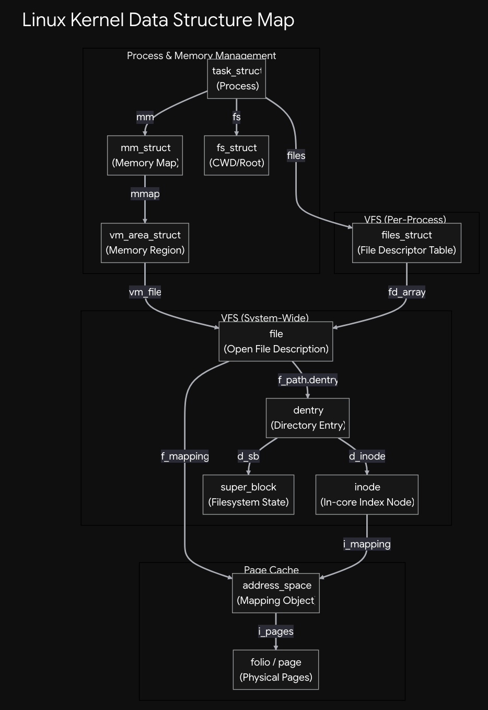

I am a backend developer. I spend my days above the kernel: APIs, queues, databases, containers. But I kept running into questions I could not answer from userspace: what does `malloc` actually do, when does memory really get allocated, and what is a process to the kernel?

So I started exploring the Linux kernel to see how things actually work deep down. The more I look, the more it feels full of clever engineering ideas built up over decades: lazy allocation, on-demand paging, and clean separations between ideas that look tangled from outside.

To learn it properly, I built a small kernel lab: boot a Linux kernel in QEMU, start a tiny userspace program, pause it at useful moments, and inspect its kernel data structures with GDB.

This is the first article in a series using that lab to explore Linux one subsystem at a time. It starts with the task and its address space, then follows the connections into virtual memory, the page cache, the VFS, and other parts of the kernel. The goal is to pair concepts with observations from a running system.

The first structure examined here is `task_struct`: the kernel's record for a schedulable task. It connects details that user-space programs usually see through separate interfaces: the task's ID and name, its address space, open files, filesystem context, and scheduler state.

This article stays at the surface level on purpose. It touches only a few `task_struct` and `mm_struct` fields to get oriented. Later articles will take a closer look at each field and subsystem, including VMAs, page tables, `files_struct`, `fs_struct`, and the page cache.



## Why run the kernel in QEMU?

QEMU gives me a disposable virtual machine in which to boot a kernel I built. If I make a mistake, I can restart the VM without disturbing my host system. Its GDB stub also lets a debugger on the host stop the guest and inspect kernel memory and CPU state.

The basic setup has three pieces:

- `bzImage`: the bootable kernel image.
- `vmlinux`: the same kernel build with debug symbols for GDB.
- An initramfs: a small root filesystem containing the test program and what it needs to run.

I run QEMU as an x86-64 guest with the kernel and initramfs, and use a serial console for output. The `-s` option opens QEMU's GDB stub on TCP port 1234. I also pass `nokaslr` so kernel addresses stay predictable while debugging. `vmlinux` and `bzImage` must come from the same build: GDB needs symbols that match the running kernel.

The test program is compiled statically with `gcc -static` and placed in the small initramfs. That avoids needing a dynamic loader and shared-library tree in the guest. The program uses `getchar()` as a checkpoint so I can stop at interesting states.

### Connecting GDB and stopping the guest

I start QEMU in one host terminal. In another, I load the matching debug-symbol file and connect to QEMU:

```text
$ gdb vmlinux
(gdb) target remote :1234
(gdb) continue
```

When the userspace program reaches `getchar()`, I press Ctrl-C in GDB. That freezes the guest so I can inspect kernel state; `continue` resumes it. This is system GDB connected to the kernel, not GDB attached to the userspace test binary.

For an even earlier stop, QEMU's `-S` option pauses the VM before the kernel begins executing. I can connect GDB first, then use `continue` to start it. In the usual lab flow, I let the guest boot and interrupt it at one of the program's checkpoints.

## Start with `task_struct`: what is a process to the kernel?

From userspace, a process looks like a running program with a PID, memory, open files, and a current working directory. Tools such as `ps` and the `/proc` filesystem expose some of that view.

Inside the kernel, the basic schedulable entity is a task represented by `struct task_struct`. Linux schedules threads: each thread has its own `task_struct`. Threads that belong to the same userspace process can share resources, including an `mm_struct` for their address space and a `files_struct` for their file descriptors.

That makes `task_struct` a useful place to begin. It is the kernel-side hub that ties a task's identity and scheduling state to pointers for resources that userspace thinks of as belonging to a process.

```text
task_struct
├── pid / tgid   task ID / thread-group ID
├── comm         short task name (16 characters maximum)
├── mm           user address space (mm_struct)
├── files        open file descriptor table (files_struct)
├── fs           filesystem context, including cwd and root (fs_struct)
└── parent       parent task
```

The PID identifies a task. The TGID is the thread-group ID that userspace generally presents as the process ID. In this single-threaded test, both are `59`, and the task name is `mm_lab1`.

## Finding the task

With the kernel's GDB helpers loaded, `lx-ps` lists tasks and their kernel addresses. Here is an illustrative excerpt from the lab; addresses vary between boots:

```text
(gdb) lx-ps
             TASK          PID    COMM
...
0xffff888004358000          59    mm_lab1

(gdb) set $task = (struct task_struct *)0xffff888004358000
(gdb) p $task->pid
$1 = 59
(gdb) p $task->comm
$2 = "mm_lab1"
(gdb) p $task->mm
$3 = (struct mm_struct *) 0xffff88800384c5c0
(gdb) p $task->files
$4 = (struct files_struct *) 0xffff8880039dc580
(gdb) p $task->fs
$5 = (struct fs_struct *) 0xffff8880043fe280
```

The helper walks the kernel's task list. Printing the entire `task_struct` would produce pages of scheduler, locking, accounting, and architecture-specific state. Looking at a few fields first gives a more useful map. I can follow `mm` next to inspect the address space.

## Follow `mm` into `mm_struct`

A userspace address space contains the program's code and data, heap, stack, shared libraries, and other mappings. The kernel describes that address space with `struct mm_struct`.

```text
mm_struct
├── mm_mt       index of virtual memory areas (VMAs)
├── map_count   number of VMAs
├── total_vm    total mapped virtual pages
├── pgd         root of the page-table hierarchy
├── start_brk   start of the heap range
├── brk          current end of the heap
└── start_stack initial stack location
```

The `mm_mt` Maple Tree indexes the VMAs. `map_count` counts regions, while `total_vm` counts virtual pages across the address space. The `pgd` points to the top of the page-table hierarchy the CPU uses when translating virtual addresses. The `brk` fields describe the traditional heap range, and `start_stack` records the initial stack location.

In GDB, I can follow the task's pointer and inspect a few values:

```text
(gdb) set $mm = $task->mm
(gdb) p $mm->map_count
$6 = 11
(gdb) p $mm->total_vm
$7 = 272
(gdb) p $mm->pgd
$8 = (pgd_t *) 0xffff8880045ce000
```

In this example, 272 pages at 4 KiB each is about 1.06 MiB of virtual address space. It does not tell us how much physical RAM is resident. That distinction will matter as we explore virtual memory.

## VMAs describe ranges; page tables translate addresses

A `vm_area_struct` describes a continuous virtual address range with common properties, such as permissions and whether it is backed by a file. A process can have separate VMAs for its code, stack, heap, shared libraries, and explicit mappings.

The `mm_struct` indexes those regions through its Maple Tree. Separately, the page tables rooted at `pgd` translate virtual addresses to physical memory. Keeping those roles distinct helps make sense of what we see in GDB:

```text
task_struct → mm → mm_struct
mm_struct   → mm_mt → VMAs
mm_struct   → pgd   → page-table hierarchy
```

Starting at `task_struct` gives us a way into the kernel's view of a task, and `mm_struct` opens the door to its address space. In the next set of articles, I’ll explore the virtual memory subsystem in more detail: how Linux represents memory regions and translates virtual addresses.
